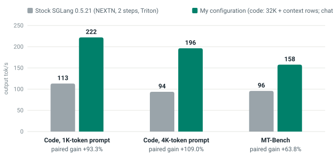
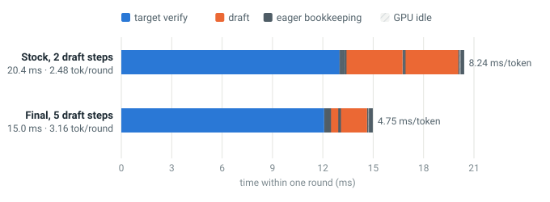

# Up to 2.09x Faster Speculative Decoding on an RTX 5070 Laptop

**A kernel-to-serving investigation of SGLang NEXTN decoding on an 8 GB GPU**  
Ravi Kothari · October 2026 · RTX 5070 Laptop (SM120) · SGLang 0.5.21 · Qwen3.5-2B BF16

**Live article:** [ravi-kot.github.io/sglang-speculative-decoding-optimization](https://ravi-kot.github.io/sglang-speculative-decoding-optimization/)  
**Repository:** [ravi-kot/sglang-speculative-decoding-optimization](https://github.com/ravi-kot/sglang-speculative-decoding-optimization)

| Code 1K | Code 4K | MT-Bench |
| :--- | :--- | :--- |
| **222.0 tok/s**, +93.3% paired gain | **196.4 tok/s**, +109.0% paired gain | **157.8 tok/s**, +63.8% paired gain |

> **Summary:** This project follows the batch-size-1 speculative-decoding critical path from SGLang's scheduler to individual CUDA kernels. A draft-only quantized output head reduced repeated weight traffic, split-KV attention exposed more verification parallelism, ReplaySSM freed memory for deeper proposals, and a reduced draft vocabulary made those proposals inexpensive. The BF16 target model remained unchanged and verified every committed token. The final paired campaign nearly doubled code throughput and improved MT-Bench throughput by 63.8% on the tested laptop GPU.



## 1. The question

Speculative decoding improves latency only when the draft proposes useful tokens more cheaply than the target can generate them directly. The initial SGLang trace showed that this condition was not yet satisfied efficiently on the RTX 5070 Laptop GPU.

The investigation asked four questions:

- Which kernels dominate one speculative round at batch size 1?
- Does each slow kernel lack bandwidth, compute throughput, or independent GPU work?
- Can an 8 GB memory budget support deeper speculation without changing the target model?
- Do isolated kernel improvements survive paired, end-to-end serving measurements?

The workload used greedy NEXTN decoding with one active request. The target was Qwen3.5-2B in BF16. All performance changes were confined to drafting, verification attention, state management, and their dispatch paths.

## 2. Verified results

The final campaign alternated stock and modified configurations in the same sessions. This paired design limits the effect of changing laptop power and clock conditions.

| Workload | Stock TPOT | Modified TPOT | Stock tok/s | Modified tok/s | Paired gain | 95% CI | Accepted tokens/round |
| :--- | ---: | ---: | ---: | ---: | ---: | :--- | ---: |
| Code 1K | 8.838 ms | **4.504 ms** | 113.2 | **222.0** | **+93.3%** | +87.2% to +96.8% | 2.48 to 3.32 |
| Code 4K | 10.671 ms | **5.091 ms** | 93.7 | **196.4** | **+109.0%** | +92.2% to +123.0% | 2.42 to 3.11 |
| MT-Bench | 10.439 ms | **6.339 ms** | 95.8 | **157.8** | **+63.8%** | +45.3% to +80.1% | 2.08 to 2.62 |

Code 1K and Code 4K refer to fixed input context lengths of 1,024 and 4,096 tokens. Both code workloads generated up to 256 output tokens. MT-Bench used fixed first-turn questions and produced up to 256 output tokens.

The displayed throughput is `1000 / median TPOT`. The paired gain is calculated from the median of per-prompt TPOT ratios, so it is not necessarily identical to the ratio of the two displayed median throughput values.

Code and chat use different final configurations. Code uses a 32K static vocabulary plus prompt-conditioned rows and an FP8 draft input projection. MT-Bench uses a 64K static vocabulary and keeps that input projection in BF16.

Full results: [`final_vs_stock_L74_L75.txt`](data/runs/final_vs_stock_L74_L75.txt)  
Correctness report: [`correctness_L75.json`](data/runs/correctness_L75.json)

## 3. What the trace revealed

A CUPTI timeline separated each speculative round into target verification, drafting, eager bookkeeping, and exposed GPU idle time.

The stock code-1K round measured 20.40 ms:

| Stage | Time per round | Engineering implication |
| :--- | ---: | :--- |
| Target verification | 12.98 ms | Verification remained the largest fixed cost |
| Drafting | 6.47 ms | Two full-vocabulary output-head calls consumed most draft time |
| Eager bookkeeping | 0.21 ms | Small but outside the captured graphs |
| Exposed GPU idle | 0.72 ms | The scheduler still left a host-dependent gap |

The draft output projection alone consumed approximately 27% of the original round's GPU time. Verification attention grew from approximately 1.41 ms per round at 1K context to 4.44 ms at 4K. Recurrent-state snapshots also reduced the KV pool enough to prevent deeper configurations from starting.

These observations established the optimization order: reduce draft-head traffic, improve verification parallelism, free recurrent-state memory, and then retune speculative depth.



## 4. The changes

### Draft-only quantized output head

The original draft head projects one hidden row of width 2,048 over a 248,320-token vocabulary. Its BF16 weight matrix is approximately 1.02 GB. At `M=1`, the operation behaves as a matrix-vector product and must stream almost the entire matrix for each draft step.

Nsight Compute measured the BF16 cuBLAS kernel at 98.3% of peak DRAM throughput with a 0.8% L2 hit rate. The kernel was already streaming memory efficiently; reducing weight bytes was more useful than increasing occupancy.

| Draft-head implementation | Weight storage | Isolated latency | Effective bandwidth | Top-1 agreement with BF16 |
| :--- | ---: | ---: | ---: | ---: |
| BF16 cuBLAS `gemvx` | 970 MiB | 2,939 µs | 346 GB/s | 100% |
| FP8 CUTLASS W8A8 | 486 MiB | 1,595 µs | 320 GB/s | 98.1% |
| FP8 Marlin W8A16 | 486 MiB | 1,515 µs | 336 GB/s | 98.2% |
| INT4 Marlin W4A16, group 32 | 273 MiB | 815 µs | 351 GB/s | 95.6% |

The final 32K reduced-vocabulary INT4 head stores approximately 36 MiB and runs in 112.9 µs inside the draft graph. Lower draft agreement can shorten the accepted prefix, so the fastest isolated kernel is not automatically the fastest serving configuration.

### Split-KV verification attention

The original Triton verification kernel launched a grid of `(1, 8, 1)`: eight CUDA thread blocks for a GPU with 36 SMs. Each block scanned the complete prefix KV sequence. The problem was insufficient independent work rather than memory bandwidth.

SGLang already contained a split-KV verification implementation. The local patch enables that existing path on CUDA behind an experiment flag, following [sgl-project/sglang#39316](https://github.com/sgl-project/sglang/pull/39316). Split-KV divides the prefix into independently processed pieces, then merges the partial attention results with the correct normalization.

| Verification path at 4K | Stage-1 grid | CTAs | Mean kernel time | Six-layer round total |
| :--- | :--- | ---: | ---: | ---: |
| Original Triton kernel | `(1, 8, 1)` | 8 | 740.2 µs | 4.44 ms |
| Split-KV plus merge | `(1, 8, 16)` plus `(1, 8)` | 128 plus 8 | 46.4 plus 12.5 µs | 0.35 ms |

Split-KV reduced the attention component by 12.6x per call. The paired end-to-end gain was larger at 4K because attention occupied more of the original round at the longer context length.

### ReplaySSM and deeper drafting

Qwen3.5-2B contains 18 Gated DeltaNet layers. SGLang's default speculative path stored recurrent-state snapshots for draft positions, consuming memory that would otherwise hold KV cache entries.

The stock `--enable-linear-replayssm-spec` path removed those snapshots and increased the measured KV capacity from 5,764 to 14,148 tokens at two draft steps. ReplaySSM was approximately speed-neutral by itself; its value was enabling four- and five-step experiments within 8 GB.

### Reduced and prompt-conditioned vocabulary

A five-step draft still paid for an output projection on every step. Restricting the draft head to frequently used tokens reduced that cost, while the full-vocabulary BF16 target continued to verify all proposals.

The static 32K map performed well for code but could not contain request-specific identifiers and uncommon prompt words. Adding up to 256 prompt-conditioned rows reduced those misses for code. MT-Bench benefited more from a broader 64K static map, which explains why the final code and chat configurations differ.

## 5. Profiler conclusion

The project exposed three different GPU performance problems:

| Problem | Evidence | Useful response |
| :--- | :--- | :--- |
| Memory-bandwidth-limited output head | 97% to 98% of peak DRAM throughput across the profiled head kernels | Reduce weight traffic with FP8, INT4, and fewer vocabulary rows |
| Insufficient attention parallelism | Eight CTAs for 36 SMs while each CTA scanned a long prefix | Split the KV sequence into more independent tasks |
| Inefficient small-M tiling | CUTLASS W8A8 gave little benefit at `M=1` and required activation quantization | Use a weight-only persistent Marlin kernel for this operating point |

These cases require different remedies. Higher occupancy does not solve a kernel that already saturates DRAM, and lower precision does not solve a kernel whose launch exposes too few independent blocks.

The Nsight Compute counters in this repository apply only to the three isolated draft-head implementations. Attention and target-verification claims use CUPTI timing and launch metadata rather than NCU counters.

## 6. Correctness and measurement method

The benchmark used:

- Batch size 1 and concurrency 1
- Fixed token-ID prompts reused across all variants
- Fresh server processes with two warm-up requests
- Alternating variant order across paired passes
- Power and memory-clock telemetry for every server
- Bootstrap confidence intervals over per-prompt TPOT ratios
- Teacher-forced validation against the plain BF16 target model

Every candidate's target-token disagreement rate minus the stock speculative path had a 95% confidence interval containing zero. This establishes no measured increase over the stock path's numerical noise for the tested prompts. It is not a claim of bitwise-identical output or unchanged quality on untested workloads.

## 7. Evidence and repository layout

| Path | Contents |
| :--- | :--- |
| [`index.html`](index.html) and [`style.css`](style.css) | Published static article and stylesheet |
| [`article.md`](article.md) | Article source used by the site generator |
| [`assets/`](assets/) | SVG figures generated from the recorded evidence |
| [`data/ledger.jsonl`](data/ledger.jsonl) | Experiment ledger, including rejected and failed runs |
| [`data/runs/`](data/runs/) | Paired comparisons, correctness, telemetry, depth sweeps, and vocabulary results |
| [`data/profiler/`](data/profiler/) | CUPTI analyses, launch configurations, NCU metric export, and head microbenchmarks |
| [`code/patches/`](code/patches/) | Source modifications against the installed SGLang 0.5.21 package |
| [`code/scripts/`](code/scripts/) | Benchmark and paired-comparison harness |
| [`code/tests/`](code/tests/) | Target-token correctness validation |
| [`code/profiling/`](code/profiling/) | Trace analysis and isolated kernel benchmarks |
| [`tools/`](tools/) | Evidence extraction and vocabulary-analysis utilities |

Ledger citations such as `L55` refer to line 55 of [`data/ledger.jsonl`](data/ledger.jsonl). The raw CUPTI traces and the approximately 70 MB Nsight Compute report are not included; the derived timing records, launch metadata, and selected NCU metrics are included.

## 8. View and rebuild the article

Preview the static site locally:

```bash
python -m http.server 8000
```

Then open `http://localhost:8000`.

Rebuild the figures and HTML from the recorded data:

```bash
pip install markdown-it-py pygments
python make_charts.py
python build_site.py
```

These commands regenerate artifacts from existing evidence. They do not run the inference benchmarks.

## 9. Attribution

- The split-KV verification kernel is existing SGLang work; the local patch enables its CUDA path in line with [SGLang PR #39316](https://github.com/sgl-project/sglang/pull/39316)
- ReplaySSM and FP8 draft-model quantization are existing SGLang features
- FP8 and INT4 execution uses SGLang's Marlin integration, derived from [IST-DASLab/Marlin](https://github.com/IST-DASLab/marlin)
- The reduced-vocabulary approach follows FR-Spec, while the tied-head composition and prompt-conditioned rows are local integration work
- MT-Bench questions come from [FastChat](https://github.com/lm-sys/FastChat)

## 10. Scope and limitations

This work establishes a paired batch-size-1 result for one model, GPU, software stack, and prompt set. It does not establish:

- Production continuous-batching or multi-request throughput
- Results on H100, L4, or other GPU architectures
- Results for larger Qwen3.5 models
- A universal speculative-depth or vocabulary policy
- An absolute throughput limit for the RTX 5070 Laptop GPU
- Bitwise-identical generations across every prompt

The remaining round is dominated by BF16 target verification. Under the measured workload, model, GPU, and precision, the implementation appears close to a weight-streaming operating point. Further gains require more accepted tokens per verification, less target-weight traffic, or an execution architecture that changes the current cost balance.

---

*Tested environment: NVIDIA RTX 5070 Laptop GPU, SM120, 36 SMs, 8 GB VRAM; Windows 11 with WSL2 Ubuntu 24.04; SGLang 0.5.21; Qwen3.5-2B BF16; PyTorch 2.13.0+cu130; Triton 3.7.1.*
