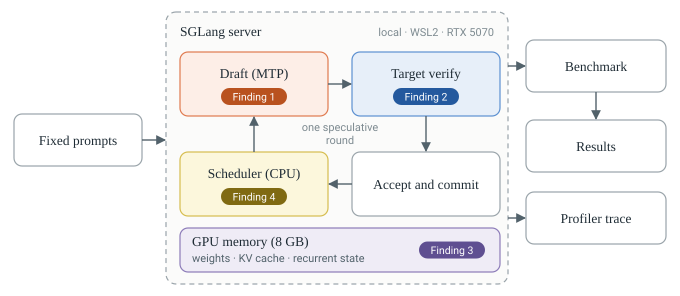
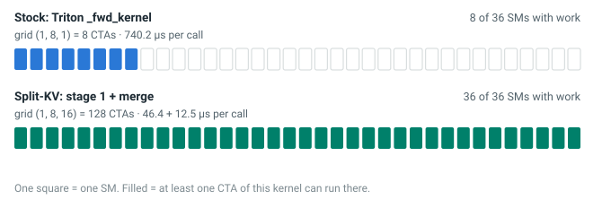
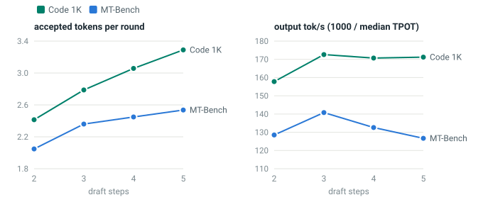
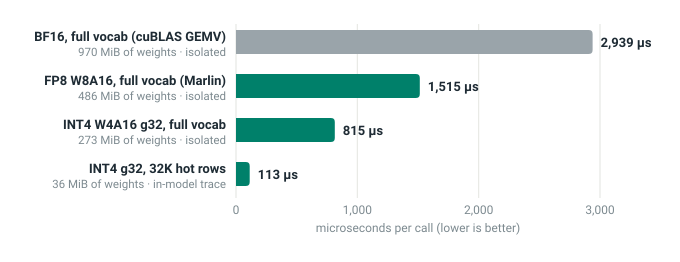
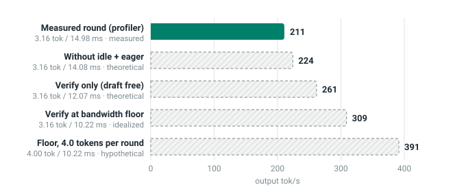

An 8 GB laptop GPU is not where anyone expects fast LLM inference. I wanted to find out how far single-request speculative decoding could be pushed on one anyway, without touching the BF16 target model. I followed each speculative round from SGLang's scheduler down to individual CUDA kernels, and then went after what the traces showed. I made drafting cheaper, and I gave the GPU more parallel work while the target verifies the draft's tokens. The target never changed: it still checks every proposed token in BF16, so the whole speedup comes from the machinery around it. Some of that machinery is my own code, and some is upstream work I enabled and combined; I separate the two in [What I built and what I reused](#what-i-built-and-what-i-reused).

<div class="stat-grid">
<div class="stat"><p class="stat-num">+93.3%</p><p class="stat-label">Code, 1K prompt<br>113.2 to 222.0 tok/s</p></div>
<div class="stat"><p class="stat-num">+109.0%</p><p class="stat-label">Code, 4K prompt<br>93.7 to 196.4 tok/s</p></div>
<div class="stat"><p class="stat-num">+63.8%</p><p class="stat-label">MT-Bench writing<br>95.8 to 157.8 tok/s</p></div>
</div>

<div class="callout">
<p><strong>Improvement:</strong> Quantized drafting, split-KV attention, deeper proposals, and a smaller draft vocabulary nearly doubled code throughput while the target model remained BF16 and continued to verify every committed token.</p>
</div>

<div class="top-table">

| Workload | TPOT, stock / mine | tok/s, stock / mine | Tokens per round, stock / mine | Paired gain |
|---|---|---|---|---|
| Code, 1K prompt | 8.838 / **4.504 ms** | 113.2 / **222.0** | 2.48 / **3.32** | **+93.3%** |
| Code, 4K prompt | 10.671 / **5.091 ms** | 93.7 / **196.4** | 2.42 / **3.11** | **+109.0%** |
| MT-Bench writing | 10.439 / **6.339 ms** | 95.8 / **157.8** | 2.08 / **2.62** | **+63.8%** |

</div>

<p class="result-scope"><strong>Scope:</strong> paired gains over stock SGLang at batch size 1, one request at a time, greedy decoding, thinking disabled. Code 1K is 6 coding-agent prompts, code 4K is 4, and MT-Bench is 4 first-turn writing prompts ({{ref:workloads}}). Code responses are technical explanations with some code, not only executable source. My correctness test found no statistically significant drop in top-1 agreement with the plain BF16 target, which stays at about 99%, as for stock (<a href="#correctness">Correctness</a>). <a class="result-link" href="#final-results">See the final benchmark results</a></p>

<div class="evidence-key">
<p><span class="tag meas">Measured</span> Recorded directly by a benchmark or profiler</p>
<p><span class="tag est">Estimate</span> Calculated using measured inputs and stated assumptions</p>
<p><span class="tag theo">Theoretical</span> A mathematical bound or hypothetical scenario, not an observed result</p>
</div>

{{toc}}

## The Problem {#the-problem}

Qwen3.5 ships a small draft model inside its own checkpoint: one extra transformer layer trained for multi-token prediction (MTP), which SGLang runs under the name NEXTN. I wanted to understand that MTP path end to end, and to see how much SGLang's speculative decoding could gain from it on hardware I own.

The machine is a laptop with an RTX 5070 Laptop GPU: Blackwell, compute capability 12.0 (SM120), 36 streaming multiprocessors (SMs), and 8 GB of GDDR7. It runs Windows 11, with SGLang inside WSL2 Ubuntu 24.04.

| Item | Value |
|---|---|
| Engine | SGLang 0.5.21, PyTorch 2.13 with CUDA 13.0, Triton 3.7.1 |
| Model | [Qwen3.5-2B](https://huggingface.co/Qwen/Qwen3.5-2B), BF16 weights, tied input and output embeddings |
| Architecture | 24 layers: 18 Gated DeltaNet (linear attention) and 6 full attention, plus one MTP draft layer |
| Vocabulary and hidden size | 248,320 tokens, 2,048 |
| Decoding | Batch size 1, greedy, NEXTN speculative decoding |
| Profilers | PyTorch profiler (CUPTI kernel traces), Nsight Compute |

{{table:setup}} Hardware and inference configuration used in every experiment

When I say "server" in this article, I mean the SGLang inference engine running locally inside WSL. It loads Qwen3.5-2B onto the GPU and manages token generation for each request. Nothing runs in the cloud.

The goal was more committed output tokens per second for a single request. I did not quantize or replace the target model. The BF16 target verifies every proposed token before it is committed, so the user still receives the target model's output.

I kept the batch size at 1: one user, one request, one response streaming back. That is the interactive case, and the hardest one for a GPU. With a single sequence there is nothing to share the cost of reading the model's weights, so every generated token pays for a full pass over all of them.

Speculative decoding attacks exactly that cost. It works in rounds:

1. The draft proposes a few tokens, one cheap step per token
2. The target checks all of them in a single forward pass
3. The target keeps the longest prefix it agrees with and adds one token of its own

When the draft is usually right, one expensive target pass commits several tokens instead of one. In NEXTN, each draft step runs the MTP layer once and then projects its output onto the full vocabulary to pick the next token. That projection turns out to matter a great deal.

{{ref:setup}} shows the whole experiment in one place: what goes into the server, what happens in each round, and what comes out.

<figure>

<figcaption>{{figure:setup}} Experiment setup: fixed prompts, the speculative round inside the local SGLang server, and the measurements that come out of it</figcaption>
</figure>

<p class="read-guide"><strong>Read this figure:</strong> follow the arrows inside the dashed box clockwise. That loop is one speculative round, and it repeats until the response is complete. Every experiment in this article changes something inside the box and leaves the prompts and the measurement path untouched. The dark badges mark where the four problems from the first profile live (<a href="#finding-1">finding 1</a> in the draft, <a href="#finding-2">2</a> in verification, <a href="#finding-3">3</a> in GPU memory, <a href="#finding-4">4</a> in the scheduler). I come back to them after the baseline is in place.</p>

- **Fixed prompts:** saved once as token IDs and hashed, so every variant sees identical input ([Building a baseline I could trust](#building-a-baseline-i-could-trust))
- **Draft (MTP):** the MTP layer plus the full-vocabulary output head, run once per proposed token ([The draft output head](#the-draft-output-head))
- **Target verify:** the BF16 target checks every draft token in a single forward pass ([Split-KV attention for verification](#split-kv-attention-for-verification))
- **Accept and commit:** keeps the longest prefix the target agrees with, plus one token of the target's own ([Correctness](#correctness))
- **Scheduler (CPU):** assigns KV slots, does the bookkeeping and launches the next round ([Approaching the memory-bandwidth limit](#approaching-the-memory-bandwidth-limit))
- **GPU memory (8 GB):** shared by the weights, the KV cache and the recurrent state ([ReplaySSM: memory for deeper drafts](#replayssm-memory-for-deeper-drafts))
- **Benchmark:** records TPOT, tokens per round, clocks and power for every request ([Requests and pairing](#requests-and-pairing))
- **Results:** paired gain with a 95% interval, plus a correctness test against the plain target ([Final paired results](#final-results))
- **Profiler trace:** CUPTI kernel traces, grouped into speculative rounds by my analyzer ([The trace that exposed the first bottlenecks](#the-trace-that-exposed-the-first-bottlenecks))

## Building a baseline I could trust

Before optimizing anything, I needed a fixed workload: the same prompts, at the same lengths, for every variant, so that any change in speed came from the code and not from the input. I modeled the code prompts on the kind of request a coding assistant typically receives, a task plus the source files it has opened, and took the chat prompts from MT-Bench. I also needed a strong stock reference, and a way to cope with a laptop GPU whose clocks move with temperature and power.

### Fixed prompts, stored as token IDs

I built every prompt once and saved the token IDs ([build_prompts.py](code/data/build_prompts.py)). Retokenizing on each run would let a template or tokenizer change slip into a comparison unnoticed. The builder applies Qwen's chat template with thinking disabled, records the tokenizer's hash and the template's token pieces, and stores a SHA-256 of every prompt set. A verify mode refuses to reuse the prompts with a different tokenizer or template.

The code prompts imitate a coding agent that has opened files. Each one is a single user turn that says "You are a coding agent working in the SGLang repository", followed by SGLang 0.5.21 source files formatted as `[tool:read_file]` outputs, then one of four tasks:

- Find the most likely bug and write the corrected function
- Trace the main call path and write pytest tests
- Refactor the longest function
- Propose an input-validation patch as a unified diff

The file context is truncated so that each complete prompt, chat template included, is exactly 1,024 or 4,096 tokens. Fixed lengths matter because attention cost grows with context. Two variants must see the same context length, or their attention work differs.

| Workload | Input | Prompts measured | Output | What the responses contain |
|---|---|---|---|---|
| Code 1K | Exactly 1,024 tokens: source files and a coding task | 6 | 256 tokens, every response hit the limit | Technical analysis in Markdown, with code blocks for the refactor and patch tasks |
| Code 4K | Exactly 4,096 tokens, same construction | 4 | 256 tokens, every response hit the limit | Same mix |
| MT-Bench | First-turn questions at natural length | 4 | Up to 256 tokens | Writing tasks: a travel blog post, two emails, an outline |

{{table:workloads}} The three benchmark workloads; "1K" and "4K" refer to input context length, not to the generated output

The chat prompts are the first four [MT-Bench](https://github.com/lm-sys/FastChat/tree/main/fastchat/llm_judge) questions, all from its writing category. That is a narrow slice of chat, and I keep it in mind when interpreting the chat results.

### Requests and pairing

Every variant runs in a fresh SGLang server process. Requests go one at a time (concurrency 1, batch size 1), after two warm-up requests ([bench.py](code/scripts/bench.py)).

TPOT, the time per output token, excludes the time to the first token:

{{eq:tpot}}

Decode throughput follows directly:

{{eq:tps}}

The laptop's enforced power limit moved between 70 and 79 W during runs. Absolute TPOT drifted by several percent between sessions as a result. So every comparison in this article is paired: stock and candidate run in the same session, on the same prompts, in two passes with opposite orders. A bench sampler records SM clock, memory clock, power and the power-cap state for every server. Passes with clock drops are re-run instead of averaged in.

The gain is computed from per-prompt ratios:

{{eq:gain}}

I report the median ratio with a bootstrap 95% interval ([compare.py](code/scripts/compare.py)).

With the measurement method fixed, the last piece was the stock baseline: SGLang 0.5.21 with Triton attention and two draft steps, which I call **S2**. I chose it because it was the fastest stock configuration I could find on this machine, not because it was the default:

- **Draft depth:** the Qwen3.5 model card recommends three draft steps. On this GPU two steps were faster: three steps measured 1.06x slower on code and 1.10x slower on MT-Bench [L4]. Four and five steps did not start at all, because the KV cache no longer fit in 8 GB [L3] [L5]
- **Attention backend:** SGLang's default on SM120 is FlashInfer, not Triton. Every FlashInfer configuration I tried was slower than Triton S2, by about 5% on code and 11% on MT-Bench [L12]. Its attention kernel was faster, but its CPU-side planning cost more than the kernel saved; I explain why in [FlashInfer: faster attention, slower serving](#flashinfer-faster-attention-slower-serving)

S2 is the strongest stock configuration I found on this machine, not a claim about every GPU or setting. These are its numbers in the final benchmark session:

| Workload | Stock S2 TPOT | Stock S2 tok/s | Tokens per round |
|---|---|---|---|
| Code 1K | 8.838 ms | 113.2 | 2.48 |
| Code 4K | 10.671 ms | 93.7 | 2.42 |
| MT-Bench | 10.439 ms | 95.8 | 2.08 |

{{table:stock}} Stock S2 in the final benchmark session; "tokens per round" counts committed tokens, including the target's own token

## The trace that exposed the first bottlenecks

Stock S2 committed about 2.5 tokens per round ({{ref:stock}}). Before touching any code, I needed to know where a round's time went. I profiled the decode loop end to end and split every round into four parts, so I could optimize each one separately:

- **Drafting:** proposing candidate tokens
- **Verification:** checking them with the target
- **Bookkeeping:** memory management and scheduler work
- **Idle:** GPU time lost between useful kernels

To get there, I recorded PyTorch profiler traces from SGLang. Under the hood these use NVIDIA's [CUPTI](https://docs.nvidia.com/cupti/), which timestamps every kernel the GPU executes and links it to the CPU call that launched it. SGLang runs the target-verify pass and the draft passes as CUDA graphs, so I wrote a small analyzer that groups kernels by the graph that launched them ([analyze.py](code/profiling/analyze.py)). The largest graph is target verification, the others are drafting, and kernels outside any graph are eager bookkeeping. I counted the gaps in the merged kernel timeline as GPU idle time.

{{ref:timeline}} previews the whole project. The top lane is the stock round I started from. The bottom lane is the round after every change in this article, with five draft steps instead of two. For now, focus on the top lane: the sections that follow explain how each of its blocks shrank, and [Choosing the speculative depth](#choosing-the-speculative-depth) explains why the final round drafts five tokens.

<figure>

<figcaption>{{figure:timeline}} GPU execution timeline of one speculative round before and after optimization, taken from CUPTI kernel traces on code 1K</figcaption>
</figure>

<p class="read-guide"><strong>Read this figure:</strong> each lane is one median round, drawn to the same time scale. Blue is the target verifying the draft's tokens, orange is the draft proposing them, dark gray is eager bookkeeping, and hatched gray is the GPU waiting for work. The top lane is stock SGLang with two draft steps [L3]. The bottom lane is my modified SGLang implementation with five draft steps, as it stood at the end of the project [L55]. The label on the right divides the round time by the tokens it committed.</p>

The stock round, in numbers [L3]:

| Part of the round | Time per round | Main kernels |
|---|---|---|
| Target verify, 3 tokens | 12.98 ms | BF16 GEMMs 11.00 ms, attention 1.41 ms, recurrent-state update 0.27 ms |
| Draft, extend pass and 1 step | 6.47 ms | Full-vocabulary output head, 2 calls of 2.79 ms each |
| Eager bookkeeping | 0.21 ms | KV-slot assignment, copies |
| GPU idle | 0.72 ms | Waiting for the CPU scheduler |
| **Round** | **20.40 ms** | **2.48 tokens, 8.24 ms per token** |

{{table:stockround}} Breakdown of the median stock round on code 1K; kernel totals over 30 rounds divided by 30 ([analysis](data/profiler/analysis_20261024-204832-local_S2.txt), [launch configurations](data/profiler/launch_configs.txt))

The trace pointed at four problems, each in a different part of the round. I numbered them because the rest of the article works through them, and each later section links back here:

1. <span id="finding-1"></span>**The draft output head took about 27% of all GPU time.** This one kernel, called twice per round, projects the draft's hidden state onto all 248,320 vocabulary rows. It cost more than the draft's whole transformer layer. Addressed in [The draft output head](#the-draft-output-head) and [Shrinking the draft vocabulary](#shrinking-the-draft-vocabulary)
2. <span id="finding-2"></span>**Verification attention grew with context.** It took 1.41 ms per round at 1K, but 4.44 ms at 4K [L19]. At 1K it hardly mattered, but long prompts are where agent workloads live. Addressed in [Split-KV attention for verification](#split-kv-attention-for-verification)
3. <span id="finding-3"></span>**Memory limited how deep the draft could go.** With three draft steps the KV pool held only 2,584 tokens, and 4K prompts were rejected [L3]. Deeper drafting, the obvious way to commit more tokens per round, could not even be tested. Addressed in [ReplaySSM: memory for deeper drafts](#replayssm-memory-for-deeper-drafts)
4. <span id="finding-4"></span>**About 0.7 ms per round was GPU idle,** with the GPU waiting for the CPU scheduler between rounds. That was real time, but only about 3.5% of the round. Quantified in [Approaching the memory-bandwidth limit](#approaching-the-memory-bandwidth-limit)

I started with finding 1. The draft head was the largest single cost, and it had a property the others lacked: changing it could not change which tokens get committed. The target re-checks every proposed token with its own BF16 head, so the draft can afford to be approximate.

## The draft output head {#the-draft-output-head}

The trace pointed at the draft output head first ([finding 1](#finding-1): 2.79 ms per call, twice per round, in {{ref:stockround}}), so I looked at the operation it performs and what made it expensive.

The draft's last step multiplies its 2,048-wide hidden state by the output-head matrix: 248,320 rows by 2,048 columns. Qwen3.5 ties this matrix to the input embedding, and in BF16 it occupies 970 MiB, or 1.017 GB.

At batch size 1 there is a single input row (M = 1). The operation is therefore a matrix-vector product. Every weight is loaded once and used for one multiply and one add, about one floating-point operation per byte. The GPU can do far more arithmetic per byte than that. So the kernel's time should be set by how fast the weights stream out of DRAM:

{{eq:gemv}}

The measured time matched that prediction. The draft runs this head once per draft step, and with two steps that is two full passes over 970 MiB every round.

The way out was not to compute faster but to read less. The draft head only proposes tokens, and the target verifies each one with its own BF16 head. So the draft can use a smaller copy of the weights without changing which tokens get committed. Fewer bytes per weight should mean proportionally less time. The cost would show up elsewhere: a less precise draft head agrees less often with the target, and each disagreement shortens a round.

### Comparing lower-precision heads

To make the head read fewer bytes, I quantized it. These are post-training quantizations (PTQ): I converted the existing BF16 weights directly, with no retraining and no calibration data. FP8 uses one scale per output row, and INT4 one scale per group of 32 or 128 weights.

I built a benchmark that runs each candidate head on 1,344 real draft hidden states against the real tied weight ([head_bench.py](code/profiling/head_bench.py)). For each one I measured latency and how often its top choice agreed with the BF16 head.

The candidates:

- **BF16:** the original head, run by cuBLAS as a GEMV kernel
- **FP8 W8A8 on CUTLASS:** 8-bit weights and 8-bit activations, through the GEMM path SGLang uses for FP8 linear layers
- **FP8 W8A16 on Marlin:** 8-bit weights, BF16 activations, dequantized inside the kernel
- **INT4 W4A16 on Marlin:** 4-bit weights with one scale per group of 32 or 128 values

| Head variant, isolated, M = 1 | Weights | Time per call | Effective bandwidth (DRAM) | Top-1 agreement with BF16 |
|---|---|---|---|---|
| BF16, cuBLAS GEMV | 970 MiB | 2,939 µs | 346 GB/s | 100% |
| FP8 W8A8, CUTLASS | 486 MiB | 1,595 µs | 320 GB/s | 98.1% |
| FP8 W8A16, Marlin | 486 MiB | 1,515 µs | 336 GB/s | 98.2% |
| INT4 W4A16, group 32, Marlin | 273 MiB | 815 µs | 351 GB/s | 95.6% |
| INT4 W4A16, group 128, Marlin | 250 MiB | 745 µs | 352 GB/s | 93.8% |

{{table:heads}} Isolated draft-head variants on the real weight and real draft inputs [L6] [L7] [L8]

Effective bandwidth here is DRAM bandwidth: weight bytes read from DRAM divided by time per call. Halving the bytes halved the time, and halving them again nearly halved it again. Every variant ran at roughly the same effective DRAM bandwidth, 320 to 352 GB/s. That pattern says the kernels were streaming weights at close to the memory system's limit, whatever their precision.

Agreement moved the other way. FP8 kept 98.2% top-1 agreement. INT4 with group-32 scales fell to 95.6%, and coarser group-128 scales to 93.8%. Every point of agreement lost turns into rounds that stop early.

The latencies told me FP8 helped, but not why Marlin beat CUTLASS when both read the same 486 MiB. I wanted to know whether these kernels were limited by memory bandwidth, by tensor-core work, or by too little parallel work.

## Nsight Compute Profiling {#nsight-compute-profiling}

{{ref:heads}} raised a question the latencies alone could not answer: why were the three head kernels so close to one bandwidth, and why did Marlin beat CUTLASS on the same bytes? I profiled the three main head kernels from that table with [Nsight Compute](https://docs.nvidia.com/nsight-compute/ProfilingGuide/index.html), using the same weights and input shapes as the benchmark [L6]. The counters explained the latency table and set the direction for the rest of the project.

| Counter | cuBLAS GEMV, BF16 | CUTLASS W8A8, FP8 | Marlin W8A16, FP8 |
|---|---|---|---|
| Grid × block | 62,080 × 64 | 1,940 × 384 | 36 × 256 |
| Registers per thread | 164 | 168 | 98 |
| Shared memory per block | 1.3 KB | 76.8 KB | 102.4 KB |
| Waves per SM | 287.4 | 53.9 | 1 |
| Theoretical warp occupancy | 25% | 25% | 16.7% |
| Achieved warp occupancy | 24.7% | 20.6% | 16.7% |
| DRAM throughput, % of peak | **98.3%** | **98.0%** | **97.0%** |
| L2 traffic | 1.03 GB | 1.02 GB | 1.05 GB |
| L2 hit rate | 0.8% | 49.9% | 51.4% |
| Issue slots used | 9.9% | 7.4% | 5.6% |
| Eligible warps per cycle | 0.11 | 0.10 | 0.06 |
| Largest stall reason, cycles per issue | Long scoreboard, 19.4 | Math pipe throttle, 13.7 | Long scoreboard 18.5, barrier 12.2 |
| Duration under Nsight Compute | 3.60 ms | 1.81 ms | 1.83 ms |

{{table:ncu}} Nsight Compute counters for the three draft-head kernels, exported from the original report ([CSV](data/profiler/head_ncu_metrics.csv))

The first row I looked at was DRAM throughput. All three kernels ran at 97 to 98% of peak, so they were already moving bytes close to the memory system's observed limit. With DRAM throughput already near that limit, increasing occupancy alone was unlikely to produce a meaningful improvement.

Occupancy looked alarming at first: 17 to 25% of the possible warps, and a tenth of a warp eligible to issue per cycle. Here it did not appear to be the limit. Marlin had the lowest occupancy of the three, one 256-thread CTA per SM, and still reached 97% of peak DRAM throughput. A kernel needs enough memory requests in flight to cover DRAM latency, and Marlin's design keeps them in flight with asynchronous copies into shared memory rather than with many warps.

The stall reasons pointed the same way. The GEMV and Marlin stalled mostly on long scoreboard, which is waiting for data from memory. Higher occupancy can sometimes hide more of that latency, even in memory-bound kernels, but with DRAM already at 97 to 98% of peak there was little bandwidth left for extra warps to use. This profile does not prove that no launch configuration could do better. It does show that reducing weight traffic was the highest-value change.

CUTLASS was the odd one out. Its largest stall was math-pipe throttle, and it also needs a separate kernel to quantize the activations to FP8 before every call. My reading is that a tile-based GEMM wastes most of each tensor-core tile when only one row is real. I did not capture tensor-pipe counters, so that part is an interpretation rather than a measurement. What I did measure is consistent with it: CUTLASS read the same bytes as Marlin but spent more time doing it once the activation pass was included.

Two cross-checks gave me confidence in the byte counts. This GPU did not expose a DRAM-bytes counter in my Nsight Compute version. <span class="tag est">Estimate</span> L2 traffic times the L2 miss rate approximates DRAM reads: 1.03 GB × 0.992 is about 1.02 GB for BF16, and 1.05 GB × 0.486 is about 0.51 GB for FP8 Marlin. Both match the weight sizes. Separately, tail effects were negligible: the GEMV ran 287 waves of CTAs and CUTLASS 54, so the last partial wave was a tiny fraction of either kernel. Durations under the profiler run longer than in the benchmark because Nsight Compute locks clocks, so I used it for ratios and stall mix, and CUDA-graph timing for latency.

This profile became the central technical lesson of the project. Three kinds of "slow kernel" need three different fixes:

- **Memory-bandwidth-limited:** DRAM is already near its limit, so the main lever is moving fewer bytes. The draft head was this case ([FP8 Marlin in the server](#fp8-marlin-in-the-server))
- **Not enough independent work:** too few CTAs to occupy the GPU, so the fix is splitting the work into more pieces. Verification attention turned out to be this case ([Split-KV attention for verification](#split-kv-attention-for-verification))
- **A small-M GEMM with mismatched tiling:** the hardware path suits large tiles, so the fix is a kernel designed for one row. The CUTLASS FP8 path at batch 1 was this case, and it came back in the draft layer ([Two smaller changes on the draft side](#two-smaller-changes-on-the-draft-side))

### FP8 Marlin in the server

That settled the first change. Of the two FP8 kernels in {{ref:heads}}, Marlin was the faster one, and the profile explained why. I wrote a draft-only FP8 copy of the head with one scale per row, run by SGLang's Marlin W8A16 kernel. The original BF16 weight stays untouched, because the target still uses it for embedding lookups and verification.

```python
class Fp8MarlinDraftHead(torch.nn.Module):
    def __init__(self, weight: torch.Tensor, chunk: int = 16384):
        super().__init__()
        n, k = weight.shape
        q = torch.empty((n, k), dtype=torch.float8_e4m3fn, device=weight.device)
        scale = torch.empty(n, dtype=torch.float32, device=weight.device)
        with torch.no_grad():
            for i in range(0, n, chunk):  # bounded temporaries: no full FP32 copy
                blk = weight[i : i + chunk].float()
                s = (blk.abs().amax(1) / FP8_MAX).clamp(min=1e-12)
                q[i : i + chunk] = (blk / s[:, None]).to(torch.float8_e4m3fn)
                scale[i : i + chunk] = s
        self.weight = torch.nn.Parameter(q, requires_grad=False)
        self.weight_scale = torch.nn.Parameter(scale, requires_grad=False)
        self.output_size_per_partition, self.input_size_per_partition = n, k
        self.orig_dtype, self.bias = weight.dtype, None
        prepare_fp8_layer_for_marlin(self, size_k_first=False)
        self.quant_method = Fp8MarlinDraftHeadMethod()
```

<p class="src">From <a href="code/patches/fp8_draft_head.diff">fp8_draft_head.diff</a>, file <code>srt/speculative/draft_lm_head_quant.py</code></p>

The object exposes a `quant_method.apply`, which SGLang's logits processor already knows how to call. A single hook in the speculative worker installs it before the draft CUDA graphs are captured. Everything is behind an environment variable. With it unset, my modified copy of SGLang ran at parity with stock [L13].

In the server, the draft fell from 6.53 to 3.83 ms per round, and the round from 20.57 to 17.80 ms [L13]. Paired against stock, that was **+15.1% on code 1K and +18.2% on MT-Bench** [L16].

INT4 was faster still in isolation, but its top-1 agreement was noticeably lower. I kept FP8 as the default and came back to INT4 later. The same idea, a quantized draft head for drafters that share the target's head, also appears in vLLM ([vllm-project/vllm#59973](https://github.com/vllm-project/vllm/pull/59973), by stecasta). My implementation for SGLang is independent. The FP8 and INT4 kernels are SGLang's Marlin kernels, derived from [IST-DASLab's Marlin](https://github.com/IST-DASLab/marlin).

## Split-KV attention for verification {#split-kv-attention-for-verification}

With the draft head cheaper, the next problem was [finding 2](#finding-2): verification attention, which grew with the prompt. In the stock 1K round it took 1.41 ms ({{ref:stockround}}). At 4K context it took 4.44 ms per round [L19], roughly in proportion to the prompt, and the share of the round it occupied grew with it.

Growth with context is expected, because attention has to read the whole KV cache. What caught my attention was how the work was launched. On the Triton backend, target verification uses SGLang's prefill attention kernel, `_fwd_kernel`. The CUPTI trace records its launch configuration: a grid of (1, 8, 1), with 256 threads, 128 registers per thread and 72 KB of shared memory per block ([launch configurations](data/profiler/launch_configs.txt)).

<figure>

<figcaption>{{figure:splitkv}} Verification attention at 4K context: how many SMs each kernel launch can give work to, with measured kernel time per call</figcaption>
</figure>

<p class="read-guide"><strong>Read this figure:</strong> a grid of (1, 8, 1) creates eight cooperative thread arrays, or CTAs. A CTA is CUDA's name for a thread block, and one CTA runs on one SM at a time (<a href="https://docs.nvidia.com/cuda/cuda-programming-guide/02-basics/intro-to-cuda-cpp.html">CUDA programming model</a>). This GPU has 36 SMs. With only eight CTAs, the original kernel could give work to at most eight SMs; the other 28 had nothing from it. Split-KV divides the KV sequence into smaller independent pieces and launches 128 CTAs, enough to give every SM work. Each square shows scheduling opportunity, not measured per-SM utilization, which I did not profile.</p>

Each of the eight CTAs handled one query head and scanned the entire KV prefix by itself, one block of keys after another. Longer context meant a longer serial scan on the same eight SMs. That explained why the time grew with context without the kernel ever being bandwidth-limited.

My first thought was to tune the kernel's launch parameters. But a different block size or warp count would not create more independent work. Each CTA would still own one complete scan. The real problem was the number of independent tasks, not the size of each one.

So I looked for an implementation that splits a long prefix safely. SGLang already contained one: a split-KV verify kernel in `verify_splitkv.py`. In version 0.5.21 it was enabled only on AMD's gfx95 GPUs. An open pull request, [sgl-project/sglang#39316](https://github.com/sgl-project/sglang/pull/39316) by rluisr, proposes enabling the same path on CUDA for the Triton backend.

### How split-KV works

The idea is the one behind [Flash-Decoding](https://pytorch.org/blog/flash-decoding/). Instead of letting one CTA scan the whole prefix, divide the prefix into chunks and give each chunk its own CTA. The chunks are processed at the same time.

Each chunk computes a partial attention result over its own keys. A partial result cannot just be added to the others, because softmax normalizes across all keys at once. So each chunk also keeps the maximum score it saw and the sum of its exponentials. A second, small kernel merges the chunks: it rescales each partial output by how its local maximum compares with the global one, then normalizes by the combined sum. This "log-sum-exp" merge gives exactly the same result as a single pass over all keys. The merge kernel also adds the small causal block where the draft tokens attend to each other.

### Enabling it on CUDA

The change I needed was a gate, not a kernel. I ported the CUDA enablement from the pull request behind an environment variable, so stock and split-KV runs stayed separable in A/B tests:

```diff
         self.use_verify_splitkv = (
-            is_gfx95_supported()
+            # Port of sgl-project/sglang#39316 (open): the split-KV verify kernel is NV-safe;
+            # opt-in on CUDA here (SGLANG_SPLITKV_VERIFY_ON_CUDA=1) so A/B runs stay separable.
+            (is_gfx95_supported() or __import__("os").environ.get("SGLANG_SPLITKV_VERIFY_ON_CUDA") == "1")
             and envs.SGLANG_ENABLE_SPLITKV_VERIFY.get()
             and self.topk == 1
         )
```

<p class="src">From <a href="code/patches/splitkv_verify_cuda_pr39316.diff">splitkv_verify_cuda_pr39316.diff</a>, file <code>srt/layers/attention/triton_backend.py</code></p>

The kernel itself is SGLang's. It handles only the cases it can serve exactly, such as a causal chain of draft tokens, and falls back to the original path otherwise. It also picks its split count from static tensor shapes, which keeps it safe inside CUDA graph capture. In my traces it launched a grid of (1, 8, 16): 128 CTAs of 128 threads.

| Verification attention at 4K | Grid | CTAs | Time per call | Per round, 6 layers |
|---|---|---|---|---|
| Triton `_fwd_kernel` | (1, 8, 1) | 8 | 740.2 µs | 4.44 ms |
| Split-KV, chunk kernel and merge | (1, 8, 16) and (1, 8) | 128 and 8 | 46.4 and 12.5 µs | 0.35 ms |

{{table:attn}} Attention launch configurations and kernel times from CUPTI traces before and after enabling split-KV [L19] [L20]

The attention kernel became 12.6x faster per call [L20]. End to end, split-KV alone improved code 1K by only 2.9%, but code 4K by 20.8% [L22]. Combined with the FP8 head, the gains over stock were +23.0% on code 1K, +40.8% on code 4K and +19.3% on MT-Bench.

The difference between 1K and 4K follows from how much of the round attention occupied. At 1K it was about 1.4 ms of a 20.4 ms round, so even removing it entirely could not do much. At 4K it was 4.44 ms of a 24.14 ms round. <span class="tag est">Estimate</span> Saving 4.09 ms predicts a round 17% shorter. The measured TPOT ratio was 0.828, a 17.2% reduction. The prediction and the measurement agreed, which told me the trace's accounting was trustworthy.

## INT4 in the server, and the limit it ran into

With attention fixed, I returned to the INT4 head. In isolation it was nearly twice as fast as FP8 ({{ref:heads}}), so I expected a clear gain.

The gain was small and partly not significant: 0.957x TPOT on code at two draft steps and 0.888x at three [L26]. Two things limited it. The lower top-1 agreement cost 0.6 to 4% of accepted tokens per round. And at two draft steps the head ran only twice per round, so after FP8 it was no longer the dominant cost.

The same session showed something more interesting. Three draft steps beat two on code, 6.31 against 6.69 ms per token, because acceptance rose from 2.44 to 2.82 tokens per round [L24]. Deeper drafting was helping. But at three steps the KV pool held only 2,584 tokens, too few for a 4K prompt, and four steps would not start at all. To go deeper I first had to find memory.

## ReplaySSM: memory for deeper drafts {#replayssm-memory-for-deeper-drafts}

This is [finding 3](#finding-3) from the first trace, now blocking real progress. The memory problem came from the model's architecture. Eighteen of its 24 layers are Gated DeltaNet layers, a form of linear attention. Instead of a KV cache that grows with every token, each of these layers keeps a fixed-size recurrent state per sequence.

That state complicates speculation. Verifying several draft tokens advances the state several times. If the target rejects some of them, the state must roll back to the last accepted token. By default SGLang keeps a full copy of every layer's recurrent state for every draft position, in a buffer called `intermediate_ssm_state_cache`. At two draft steps that buffer took 0.11 GB, and it grows with depth.

On an 8 GB GPU that buffer decided what fit:

- With three draft steps, the KV pool shrank to 2,584 tokens [L3]
- Four and five steps failed at startup with "Loaded weights leave no GPU memory for the KV cache" [L5]

SGLang has a stock alternative, enabled with `--enable-linear-replayssm-spec`. ReplaySSM stores the raw per-draft inputs, which are much smaller than full state copies. When the target decides how many tokens to accept, it replays only those inputs onto the committed state.

| | Before | With ReplaySSM |
|---|---|---|
| Per-draft recurrent-state snapshots | 0.11 GB | 0 |
| KV pool, 2 draft steps | 5,764 tokens | 14,148 tokens |
| KV pool, 3 draft steps | 2,584 tokens | 14,148 tokens |
| Recurrent-state verify kernel | 0.25 ms per round | 0.18 ms per round |
| Round time, 2 steps, code 1K | 14.66 ms | 14.62 ms |

{{table:replayssm}} Effect of ReplaySSM on memory and round time [L32]

SGLang sizes the KV pool from whatever memory remains inside its static budget (85% of the GPU here) after weights, CUDA graphs and the recurrent-state pools. Memory freed from the snapshots goes straight into the KV pool.

<span class="tag est">Estimate</span> On this model a KV token is cheap, because only the 6 full-attention layers store keys and values, each with 2 KV heads of dimension 256:

{{eq:kv}}

At that size the 0.11 GB freed is worth roughly 8,000 tokens, consistent with the measured increase of 8,384 tokens.

ReplaySSM did not make anything faster; the round time stayed within noise. Its value was the memory, and with it four and five draft steps finally fit.

## Choosing the speculative depth

With memory available, the question became how deep to draft. More steps propose more tokens, but they are not free. Each step costs a draft pass, and each extra token makes verification slightly more expensive. Throughput depends on both:

{{eq:round}}

An extra step pays off only if it raises the committed tokens per round by a larger fraction than it raises the round time:

{{eq:step}}

I swept two to five steps in one paired session [L35] [L36].

<figure>

<figcaption>{{figure:depth}} Accepted tokens per round and decode throughput against draft depth, from one paired session with the INT4 head, split-KV verification and ReplaySSM</figcaption>
</figure>

| Draft steps | Code 1K tokens per round | Code 1K tok/s | MT-Bench tokens per round | MT-Bench tok/s |
|---|---|---|---|---|
| 2 | 2.41 | 157.8 | 2.05 | 128.5 |
| 3 | 2.79 | 172.6 | 2.36 | 140.8 |
| 4 | 3.06 | 170.7 | 2.45 | 132.6 |
| 5 | 3.29 | 171.2 | 2.54 | 126.7 |

{{table:depthsweep}} Draft-depth sweep ([data](data/runs/depth_sweep_L35_L36.txt))

Acceptance kept rising, but code throughput went flat after three steps and chat throughput fell. The rule above explains why. Profiling four and five steps on code gave rounds of 17.71 and 19.03 ms [L37]:

{{eq:depth45}}

The fifth step bought exactly as much acceptance as it cost in time. Each draft step still cost about 1.2 ms, most of it the draft's output head and its single transformer layer. Deeper drafting would only pay if each step got much cheaper.

## Shrinking the draft vocabulary

Quantization had cut the draft head's bytes per row ([finding 1](#finding-1)); the next step was to read fewer rows. The cheapest bytes are the ones never read. Most of the 248,320 vocabulary rows are rarely the next token. The idea published as [FR-Spec](https://arxiv.org/abs/2502.14856) restricts the draft's output head to the most frequent tokens, and SGLang exposes it as `--speculative-token-map`.

I built 32K and 64K maps from text that does not overlap my prompts: CPython standard-library sources and Python package metadata, 721 files and 3.4M tokens ([build_token_map.py](code/data/build_token_map.py)). Special tokens are always kept.

The stock token map crashed on this model with a device-side "index out of bounds" assertion [L2]. Qwen3.5's draft ties its head to the embedding, and the model's `set_embed_and_head` ignores the reduced head when embeddings are tied. The draft kept producing indices over the full vocabulary, which the map then indexed out of range. An upstream fix is open ([sgl-project/sglang#42094](https://github.com/sgl-project/sglang/pull/42094), by SamMausberg). My quantized-head module avoids the problem by selecting the hot rows itself:

```python
    if hot_token_id is not None and weight.shape[0] != hot_token_id.numel():
        # Tied Qwen3.5 MTP keeps the full embedding as its head: take the hot rows here so the
        # draft's logits match hot_token_id (which maps draft top-k back to vocabulary ids).
        weight = weight.index_select(0, hot_token_id.to(weight.device))
```

The draft's argmax is then an index into the reduced vocabulary, and SGLang's draft loop maps it back to a real token ID:

```python
        if self.hot_token_id is not None:
            topk_index = self.hot_token_id[topk_index]
```

Combining the reduced vocabulary with INT4 shrank the head dramatically:

{{eq:head32k}}

<figure>

<figcaption>{{figure:headtime}} Draft output-head time per call across the project, from isolated benchmarks for the full-vocabulary heads and from the final CUPTI trace for the 32K-row head</figcaption>
</figure>

The head went from 970 MiB to 36 MiB, 27x fewer bytes per draft step. In the final draft graph it takes 112.9 µs per call, against 2,786 µs for the full BF16 head in the stock trace. Over a five-step round the draft fell from 6.22 to 2.70 ms, and the round from 19.03 to 15.48 ms [L41].

The price is coverage. The draft can never propose a token outside the map, so when the target wants one, the round stops at that position. Code fell from 3.29 to 3.16 tokens per round with 64K rows, and to 3.10 with 32K [L41]. Correctness is not at stake, because the target still verifies with its full BF16 head. A missing token only shortens a round.

The trade was clearly worth it. Paired against stock, code 1K went from +44.3% to **+64.3%**, code 4K from +70.6% to **+92.5%**, and MT-Bench from +37.4% to **+57.4%** [L36] [L43]. With cheap draft steps, five steps now beat three on code.

## Two smaller changes on the draft side

The head was now small, so the rest of the draft step became the next target.

**An FP8 draft layer.** SGLang can quantize the draft model's transformer layer with `--speculative-draft-model-quantization fp8`. The stock path chose the CUTLASS W8A8 GEMM, which barely helped at batch 1: 1,369 against 1,444 µs per round for the BF16 kernels it replaced [L46]. That was the small-M tiling problem from the Nsight Compute profile, now inside the draft layer. Routing the FP8 layer to Marlin's weight-only kernel with `SGLANG_FORCE_FP8_MARLIN=1` cut the draft from 2.55 to 2.03 ms per round [L47]. Code 1K reached +74.8% over stock [L49].

**Split-KV for the draft-extend pass.** After each verification, the draft runs an "extend" pass over the newly accepted tokens to refresh its own KV cache. In a 4K trace that pass still used the serial `_fwd_kernel`, 494 µs per round. It is the same causal prefix-plus-chunk problem as verification, so I let the split-KV path serve it too:

```diff
-            and forward_batch.forward_mode.is_target_verify()
+            and (
+                forward_batch.forward_mode.is_target_verify()
+                # Draft extend (spec v2) is the same causal prefix+chunk problem; opt-in so A/B
+                # stays separable. can_handle() still rejects anything non-causal/ragged.
+                or (
+                    forward_batch.forward_mode.is_draft_extend_v2()
+                    and __import__("os").environ.get("SGLANG_SPLITKV_DRAFT_EXTEND") == "1"
+                )
+            )
```

<p class="src">My extension, in the same patch; the kernel is SGLang's</p>

At 4K the draft fell from 3.11 to 2.53 ms per round [L51]. Paired in the same session, code 4K went from +95.0% to +105.3% over stock, and code 1K from +71.8% to +75.3% [L53].

At this point a five-step round on code 1K took 14.98 ms: 12.07 ms of verification, 1.97 ms of drafting, 0.18 ms of eager bookkeeping and 0.71 ms of idle [L55]. A draft step cost about 0.39 ms, a third of what it had cost before the vocabulary change.

## Context-augmented draft vocabulary

The next clue came from a side result. While testing adaptive depth (described among the experiments I did not keep), I also ran the 64K map at five steps. MT-Bench acceptance jumped from 2.32 to 2.62 tokens per round, against the 32K map [L65]. The vocabulary was costing more acceptance than I had assumed.

So I measured how often the target emits a token the draft cannot propose. This is an offline count over the stock outputs ([vocab_coverage.py](tools/vocab_coverage.py), [output](data/runs/vocab_coverage.txt)):

| Target tokens outside the draft vocabulary | Code 1K | Code 4K | MT-Bench |
|---|---|---|---|
| 32K corpus map | 3.71% | 2.34% | 12.81% |
| 48K map, half corpus and half tokenizer rank | 2.99% | 1.95% | 4.06% |
| 64K corpus map | 1.24% | 0.59% | 2.71% |
| 32K map plus the request's own prompt tokens | **0.91%** | **1.27%** | 11.82% |
| Share of 32K misses that appear in the prompt | 75% | 46% | 8% |

{{table:coverage}} How often the target's next token is missing from the draft vocabulary, measured on recorded stock outputs

Three quarters of the code misses were tokens from the prompt itself: identifiers, file names and unusual words the response copies from the files it read. A frequency map built in advance cannot know them, but the prompt contains them.

That suggested a draft head with two parts:

- The static INT4 head over the 32K map
- A small BF16 block of up to 256 extra rows, filled with the prompt's tokens that the map lacks

Each request's prefill fills the extra rows, outside any CUDA graph:

```python
    @torch.no_grad()
    def update(self, input_ids: torch.Tensor) -> None:
        ids = input_ids[(input_ids >= 0) & (input_ids < self.in_map.numel())]
        new, cnt = torch.unique(ids[~self.in_map[ids]], return_counts=True)  # host sync: prefill only
        if new.numel() > self.slots:
            new = new[cnt.topk(self.slots).indices]
        n = new.numel()
        self.hot_ext[self.k : self.k + n] = new
        self.dyn_w[:n] = self.full_weight.index_select(0, new)
        self.dyn_mask[:n] = 0
        self.dyn_mask[n:] = self.neg
```

<p class="src">From <a href="code/patches/fp8_draft_head.diff">fp8_draft_head.diff</a>, class <code>ContextVocabHead</code> in <code>srt/speculative/draft_lm_head_quant.py</code></p>

The details that make it work:

- **Deduplication:** `torch.unique` keeps each missing token once, and if more than 256 are missing the most frequent win. The largest prompt in my sets needed 67 rows
- **Remapping:** the token-ID map is extended by 256 slots, so the same stock line that maps hot indices back to token IDs also covers the dynamic rows
- **Logits:** the head returns the static logits concatenated with `x @ dyn_w.T + dyn_mask`. Unused slots carry the most negative value, so they can never win the argmax
- **CUDA graphs:** the buffers are allocated once and updated in place, so the captured draft graphs see each new prompt's rows without being captured again. The only host synchronization is one `torch.unique` per request, at prefill
- **Cost:** 256 rows of 2,048 BF16 values add 1 MiB of reads per draft step, next to 36 MiB for the static head

The context-conditioned head currently targets single-request inference. Its dynamic rows are stored in shared buffers. Supporting concurrent requests will require request-specific state management and additional correctness testing.

| Configuration, paired against the 32K map | Code 1K | Code 4K | MT-Bench | Tokens per round, code 1K and MT-Bench |
|---|---|---|---|---|
| 32K map, reference | 0 | 0 | 0 | 3.16 and 2.32 |
| 32K map and context rows | **+4.1%** (0.8 to 6.1) | +1.0% (−0.8 to 8.1) | +1.7% (−0.2 to 4.5) | 3.24 and 2.36 |
| 48K blended map and context rows | +1.2% | +3.6% | +5.3% (2.5 to 10.4) | 3.25 and 2.49 |
| 64K map | +0.9% | −2.1% | **+10.5%** (7.0 to 13.6) | 3.27 and 2.62 |
| 64K map and context rows | +1.6% | −0.7% | +6.8% (3.0 to 14.9) | 3.27 and 2.57 |

{{table:vocab}} Draft-vocabulary variants pooled over four paired passes, or two for the 48K and 64K-with-context rows, with 95% intervals in parentheses where significant [L68] [L69] [L70] [L71] ([data](data/runs/vocab_pooled_L68-L71.txt))

Context rows raised acceptance on every workload, and the gain was significant on code 1K, the workload they were designed for. Chat behaved differently: only 8% of its misses came from the prompt. The writing prompts simply use a broader vocabulary, which the 64K map covers better than any prompt-based addition. So the two workloads ended up with different draft vocabularies.

One last draft-side detail paid off for code. The draft layer's input projection, a 4096-to-2048 `nn.Linear` called `fc`, is a plain PyTorch module that SGLang's FP8 draft quantization skips. The final trace still shows a 512-CTA BF16 GEMV of 49.6 µs, four times per round; its shape matches this projection. An FP8 Marlin copy raised code acceptance from 3.24 to 3.32 tokens per round, and the final code configuration measured **+6.8%** (3.7 to 9.3) over the previous best [L75].

The same projection behaved differently on chat. An INT4 copy dropped MT-Bench acceptance to 2.39 [L72], and even FP8 lowered it with the 64K map, from 2.62 to 2.52, in two separate runs [L73] [L75]. The chat configuration therefore keeps this projection in BF16.

## Approaching the memory-bandwidth limit

After these changes the draft is small, and the profile looks very different from where I started. Verification took 12.07 of the 14.98 ms round [L55]. Inside verification, the target's BF16 GEMMs took about 11 ms. Was there much left to gain?

The target's linear layers hold 3.763 GB of BF16 weights: the output head plus every projection in all 24 layers ([gemm_bench.py](code/profiling/gemm_bench.py), [L38]). That is hundreds of times larger than the GPU's on-chip L2 cache, so each verification pass has to stream the weights from DRAM again. The best BF16 streaming rate I measured on this GPU was about 368 GB/s.

<span class="tag theo">Theoretical</span> Under three assumptions, a lower bound on the time of one verification pass follows: every weight byte is read from DRAM exactly once per pass, nothing is reused from cache between passes, and 368 GB/s is the sustainable rate.

{{eq:floor}}

The byte count is an estimate from the weight shapes; I could not read a DRAM-bytes counter for these kernels. Against that estimate, the measured verification GEMMs took 10.73 ms at six tokens per pass, about 95% of the floor [L38]. The rest of verification, attention, recurrent-state updates and normalization, added about 1.1 ms. So verification is running close to what streaming the weights alone would require.

Throughput per round combines that time with the committed tokens:

{{eq:ceil}}

The paired benchmark measured 213.8 tok/s for the same configuration in the same session [L53]. The difference comes from aggregation. The profiler number combines the median round of one profiled request with the benchmark's mean acceptance, while the benchmark takes the median TPOT over twelve requests.

The same equation shows why acceptance remains the strongest lever. Verification costs nearly the same whether it checks four tokens or six, because the weights are read once per pass either way. Every additional accepted token is close to free throughput, as long as producing it does not add much draft time. That is why deeper drafting paid off only after each draft step became cheap.

<figure>

<figcaption>{{figure:ceiling}} Measured throughput of the code 1K configuration next to theoretical scenarios that remove parts of the round or raise acceptance</figcaption>
</figure>

| Scenario | Round time | Tokens per round | tok/s | Kind |
|---|---|---|---|---|
| Measured round | 14.98 ms | 3.16 | 211 | <span class="tag meas">Measured</span> |
| Remove the 0.71 ms scheduler idle | 14.27 ms | 3.16 | 221, +5.0% | <span class="tag theo">Theoretical</span> |
| Remove idle and eager bookkeeping | 14.08 ms | 3.16 | 224, +6.3% | <span class="tag theo">Theoretical</span> |
| Verification only, draft free | 12.07 ms | 3.16 | 261, +24% | <span class="tag theo">Theoretical</span> |
| Verification at the bandwidth floor, nothing else | 10.22 ms | 3.16 | 309 | <span class="tag theo">Theoretical</span> |
| Bandwidth floor with 4.0 tokens per round | 10.22 ms | 4.0 | 391 | <span class="tag theo">Theoretical</span> |

{{table:scenarios}} Throughput scenarios built from the measured round [L55] and the bandwidth floor [L38]

The scheduler idle, [finding 4](#finding-4) from the first trace, is a useful example of a modest ceiling. It is real time, but removing all of it would add only 5%, and getting there means moving SGLang's speculative bookkeeping onto the GPU.

Depth has its own limit. Five draft steps give a six-token linear chain, at most six committed tokens per round, and the profiled code configuration averaged 3.16. A sixth step raised acceptance by only 0.5% in a paired test, far less than it added to the round. Adding steps to a single chain has reached the point of diminishing returns. Branching tree drafts could raise acceptance further, but ReplaySSM, which made this depth fit in memory, supports only linear chains.

My implementation appears close to a bandwidth-limited operating point for this workload, model, GPU and target precision. That does not establish the maximum throughput this GPU can deliver. A figure around 250 to 260 tok/s is roughly what this configuration would reach if everything except verification disappeared at today's acceptance. Going well beyond that needs more accepted tokens per verification, fewer target weight bytes, or an execution design that changes the balance between drafting and verification. 1,000 tok/s, for instance, would need about 10 committed tokens per round even at the bandwidth floor.

## Experiments I did not keep

The complete record is the [experiment ledger](data/ledger.html): 75 entries, including every failure. These were the most instructive.

### A merge kernel that was 20% faster and did not matter

The split-KV merge kernel launched one warp per program, a value tuned for AMD's 64-wide wavefronts. Since it now ran on NVIDIA's 32-wide warps, I suspected that setting was suboptimal. An isolated sweep with real shapes found four warps about 20% faster per call: 26 to 21 µs at 1K and 49.5 to 40.5 µs at 4K [L54] ([splitkv_bench.py](code/profiling/splitkv_bench.py)).

Before putting it into a paired run, I estimated what it could change. All split-KV attention together took about 0.5 ms per round at 4K, across seven calls. <span class="tag est">Estimate</span> A 20% faster merge would save about 0.1 ms per round, roughly 0.6% end to end. That is below what my paired runs can resolve on this laptop, about 3 to 5%. I reverted it. A faster kernel is only worth keeping if its share of the round is large enough to show.

### FlashInfer: faster attention, slower serving

FlashInfer is SGLang's default attention backend on this GPU, so I measured it before choosing my baseline. Its verification attention took 101 µs per round against Triton's 1,463 µs in the same trace [L10]. Yet every FlashInfer configuration was 5 to 11% slower end to end [L12].

The time went to the CPU. FlashInfer's planning step needs the sequence lengths on the host, which forced a synchronization and several small copies every round. That stopped the scheduler from preparing the next round while the GPU was still busy, and GPU idle time grew to 3.2 ms per round. A hybrid with FlashInfer for verification and Triton for decoding still lost [L17]. The lesson was to account for host-side work before trusting a kernel benchmark.

### Six draft steps

After the vocabulary change made draft steps cheap, I tried going deeper again. A single unpaired run put six steps at 4.40 ms per token, better than five [L51]. The paired test disagreed: −3.6% on code 1K (−6.4 to 0.4) and +1.2% on code 4K, both within noise [L53].

The depth rule explains why. Acceptance rose from 3.156 to 3.173 tokens per round, only 0.5%. One more draft step costs at least 0.39 ms of a 14.98 ms round, 2.6%, before any extra verification cost. Since then, unpaired numbers stay out of my tables.

### Adaptive depth

Chat preferred fewer draft steps than code, so I tried SGLang's adaptive mode, which switches depth at runtime from a moving average of acceptance. I configured it to switch between three and five steps. With a narrow hysteresis band it flipped depth every four rounds. With a wider band it was stable, but the paired results were +0.9%, +3.4% and +1.1%, all with intervals that included zero [L59] [L64] [L65]. It did not justify its complexity.

### An INT4 projection that changed acceptance

Quantizing the draft layer's input projection to INT4 looked like a free saving of about 0.2 ms per round. It cut MT-Bench acceptance from 2.62 to 2.39 tokens per round [L72], which cost far more than the projection's time. In the draft, small numerical errors matter when they change which token gets proposed.

### Clock throttling and measurement quality

One paired pass ran while the memory clock dropped from 12,001 to 9,001 MHz, and one configuration came out 2.2x slower [L67]. Memory bandwidth sets the speed of almost everything here, so a lower memory clock invalidates a comparison. I discarded the pass and re-ran it. The bench now logs clocks and power for every server.

### Smaller dead ends

| Idea | What happened | What it taught me |
|---|---|---|
| cuBLASLt chooses better kernels for skinny GEMMs | 96% of the bandwidth floor at every M, but at six tokens cuBLAS was already at 95% [L38]; the paired pass was power-throttled [L39] [L40] | Check the operating point before tuning |
| One 48K blended map can serve every workload | +5.3% on MT-Bench but best on none [L71] | Code and chat disagree, so two configurations beat one compromise |
| A provably exact INT4 screen for the target's head | Exact by construction, with 0 of 2,046 argmax mismatches, but the error bound was too loose and needed 420 MiB of VRAM [L58] | Parked for a GPU with more memory |
| Deep draft graphs are always smaller than the target graph | My analyzer first labeled five-step draft graphs as target work [L44] | Classify by the largest graph and sanity-check the totals |
| WSL swapping causes rare slow runs | Swap activity also occurred in normal runs [L34] | Ruled out; two intermittent slowdowns remain unexplained |
| Remove the scheduler's per-round host synchronization | The idle comes from SGLang returning accept lengths to the CPU each round [L50] | Deferred: about 5% at best, with real memory-safety risk |

{{table:deadends}} Smaller experiments and what each one showed

## Final paired results {#final-results}

These are the final runs. Stock SGLang and my implementation ran in the same session, on the same prompts, alternating order across two passes [L74] [L75].

| Workload | Stock TPOT | Stock tok/s | My TPOT | My tok/s | Paired gain | 95% interval | Tokens per round, stock and mine |
|---|---|---|---|---|---|---|---|
| Code 1K | 8.838 ms | 113.2 | **4.504 ms** | **222.0** | **+93.3%** | 87.2 to 96.8 | 2.48 and 3.32 |
| Code 4K | 10.671 ms | 93.7 | **5.091 ms** | **196.4** | **+109.0%** | 92.2 to 123.0 | 2.42 and 3.11 |
| MT-Bench | 10.439 ms | 95.8 | **6.339 ms** | **157.8** | **+63.8%** | 45.3 to 80.1 | 2.08 and 2.62 |

{{table:final}} Final paired benchmark: absolute throughput is 1000 divided by median TPOT, and the gain is the median of per-prompt paired ratios ([data](data/runs/final_vs_stock_L74_L75.txt))

<figure>

<figcaption>{{figure:results}} Decode throughput of stock SGLang and my implementation in the final paired session</figcaption>
</figure>

The absolute throughput and the paired gain measure slightly different things. The absolute numbers divide 1000 by each configuration's median TPOT. The paired gain is the median of per-prompt ratios, which cancels prompt-to-prompt differences. For code 1K, the ratio of medians is 222.0 / 113.2 = 1.96x, while the paired median is 1.93x.

Code and chat use different configurations. Neither one is best on all three workloads.

| | Code configuration | Chat configuration |
|---|---|---|
| Draft steps per round | 5 | 5 |
| Draft output head | INT4, 32K static rows and up to 256 prompt rows | INT4, 64K static rows |
| Draft transformer layer | FP8 on Marlin, including its input projection | FP8 on Marlin, input projection in BF16 |
| Verification attention | Split-KV, CUDA gate ported from PR 39316 | Split-KV |
| Draft-extend attention | Split-KV, my extension | Split-KV |
| Recurrent-state rollback | ReplaySSM, stock SGLang flag | ReplaySSM |
| Target model | BF16, unchanged | BF16, unchanged |

{{table:configs}} The two final configurations

At 4K the chat configuration measured 196.6 tok/s (+111.6%). That is a statistical tie with the code configuration, not a separate win.

The final session ran with the laptop at its power limit. The enforced limit moved between 70 and 79 W, and the software power cap was active in 71 to 100% of samples ([telemetry](data/runs/telemetry_L74_L75.txt)). An earlier session, in which stock itself ran about 4% faster, measured 213.8 tok/s for code 1K and 204.3 tok/s for code 4K with the previous code configuration [L53]. I report the final session because it compares all three workloads against the same stock run. Absolute throughput should not be compared across sessions; paired gains within a session should.

### What produced the gains

Each step below was measured against stock S2 in its own session, using the best configuration for each workload at that point.

| Step | Code 1K | Code 4K | MT-Bench |
|---|---|---|---|
| FP8 draft head [L16] | +15.1% | not measured | +18.2% |
| Split-KV verification [L22] | +23.0% | +40.8% | +19.3% |
| INT4 head with re-tuned depth [L29] [L31] | +37.9% | +48.5% | +28.0% |
| ReplaySSM and deeper drafting [L36] | +44.3% | +70.6% | +37.4% |
| Reduced draft vocabulary [L43] | +64.3% | +92.5% | +57.4% |
| FP8 draft layer on Marlin [L49] | +74.8% | +103.5% | +60.7% |
| Split-KV draft extend [L53] | +75.3% | +105.3% | +60.4% |
| Context rows and FP8 projection for code, 64K map for chat [L75] | **+93.3%** | **+109.0%** | **+63.8%** |

{{table:progression}} Paired gain over stock after each kept change; each row's baseline is the stock run of its own session, so steps are indicative rather than strictly additive

The largest single steps were the reduced draft vocabulary, worth about 20 points on every workload, and split-KV for long prompts. ReplaySSM enabled the depth that made the reduced vocabulary pay off. The context rows added the last large step for code.

All results are for batch size 1 and one request at a time. They say nothing about throughput under concurrent requests or continuous batching.

### What I built and what I reused {#what-i-built-and-what-i-reused}

Most of these gains came from combining pieces, and not all of the pieces are mine. Some are existing SGLang features or open upstream work that I enabled, ported or tuned for this GPU. I want to be clear about which is which.

| Component | Origin | Notes |
|---|---|---|
| Draft-only FP8 and INT4 output head | New in this work | My SGLang implementation; vLLM independently merged a quantized draft head ([vllm-project/vllm#59973](https://github.com/vllm-project/vllm/pull/59973)) |
| Quantized head combined with a reduced vocabulary | New in this work | Also avoids the tied-embedding token-map crash, for which an upstream fix is open ([sgl-project/sglang#42094](https://github.com/sgl-project/sglang/pull/42094)) |
| Context-augmented draft vocabulary | New in this work | Prompt tokens added to the draft head at prefill, single-request only for now |
| FP8 copy of the draft's input projection | New in this work | Kept for code, left in BF16 for chat |
| Split-KV for the draft-extend pass | New in this work | My gate; the kernel is SGLang's |
| Split-KV verification on CUDA | Existing, ported | Open pull request [sgl-project/sglang#39316](https://github.com/sgl-project/sglang/pull/39316) by rluisr |
| ReplaySSM | Existing, enabled | Stock SGLang flag |
| FP8 draft layer on Marlin | Existing, enabled | Stock SGLang flags |
| Reduced draft vocabulary | Existing, tuned | The [FR-Spec](https://arxiv.org/abs/2502.14856) idea and SGLang's token-map flag; the maps are mine |
| FP8 and INT4 Marlin kernels | Existing | SGLang's kernels, derived from [IST-DASLab's Marlin](https://github.com/IST-DASLab/marlin) |

{{table:origin}} Which parts of the final configurations are new in this work and which are existing upstream work

## Correctness

Speculative decoding is lossless when every committed token is the target's own greedy choice given the tokens committed before it. I tested exactly that ([test_correctness.py](code/tests/test_correctness.py)).

For every recorded output, the plain target model, without speculation, scores the prompt and output with teacher forcing. Each output token should be the target's top choice, apart from numerical near-ties. Stock speculative decoding itself does not reach 100% on this test, because verification and prefill compute the same logits through slightly different kernels. So stock sets the noise floor, and a configuration fails only if its disagreement rate is significantly higher than stock's.

| Final pass | Code 1K top-1 agreement | Code 4K | MT-Bench |
|---|---|---|---|
| Stock S2 | 99.54% | 99.51% | 98.89% |
| Code configuration | 99.48% | 99.12% | 98.89% |
| Chat configuration | 99.41% | 99.22% | 98.97% |

{{table:correctness}} Share of committed tokens that match the plain target's top choice [L75] ([report](data/runs/correctness_L75.json))

Every difference from stock had a 95% interval that included zero.

This is not proof of identical output. Changing the draft changes how many tokens each verification pass processes, and that changes rounding inside the target's BF16 GEMMs. Greedy outputs therefore diverge at near-ties. Across the two final passes, half of the code 1K outputs matched stock exactly, and the average shared prefix was 172 of 256 tokens [L74] [L75]. The test shows no measurable increase in disagreement with the target. It does not show equal task quality on other workloads.

## Where the investigation goes next

In rough order of practicality:

1. **More acceptance for the same draft cost.** The context rows showed that vocabulary coverage still matters. Adding tokens as the response generates them, and choosing the map per request, are small changes
2. **Split-KV launch selection for SM120.** The kernel's split count and tile sizes were tuned on AMD hardware, and the merge kernel launches only 8 CTAs. The gain is small but nearly free
3. **Long-context attention.** At 4K, verification attention is still the part of the round that grows with the prompt
4. **GPU-side speculative bookkeeping.** Removing the 0.7 ms per-round idle means letting the GPU allocate KV slots and update sequence lengths without a round trip to the CPU. That is real architectural work in the scheduler
5. **A different target precision, as a separate experiment.** An FP8 target would roughly halve the verification floor, but it changes the model's outputs and needs a quality evaluation, not just a speed measurement
6. **Other GPUs.** Everything here was measured on one laptop. On an L4 or an H100, the balance between draft cost, attention and weight streaming will be different

## Lessons I would carry forward

A faster kernel is not always a faster inference system. The 12.6x attention kernel moved code 1K by 3%, the 20% faster merge kernel would have moved nothing, and the FP8 GEMM that read half the bytes barely beat BF16 at batch 1.

The quantity that matters is useful committed tokens divided by total execution time. The trace showed me where the time went. The profiler showed me which kind of limit each kernel had. A quick estimate of each change's share of the round told me whether it could matter before I spent an hour measuring it.

## Methodology notes

- **Ledger citations:** links such as L53 open entry 53 of the [experiment ledger](data/ledger.html), which lists every run's hypothesis and result in order. The raw records are in [ledger.jsonl](data/ledger.jsonl)
- **Nsight Compute scope:** the only Nsight Compute data is for the three draft-head kernels in {{ref:ncu}}, profiled in isolation. Statements about verification GEMMs, attention and the final INT4 head come from CUPTI kernel traces (timestamps and launch configurations) and CUDA-graph timing, not from hardware counters
- **Counters not captured:** tensor-pipe utilization and per-SM activity were not measured, so the CUTLASS tiling explanation and the split-KV scheduling diagram describe structure and opportunity rather than measured utilization
- **Timeline source:** Nsight Systems could not record GPU activity with the Windows driver available to WSL at the time, so all kernel timelines come from CUPTI through the PyTorch profiler
- **Per-round times:** kernel totals in a trace are divided by its 30 recorded rounds. One early ledger entry divided by 29 and reported 1.46 ms instead of 1.41 ms for 1K attention
- **Rounding:** paired gains are computed from unrounded ratios, so recomputing them from the rounded ratios shown can differ in the last digit

## Evidence, code and references

**Source code and patches**

- [fp8_draft_head.diff](code/patches/fp8_draft_head.diff): quantized draft head, reduced-vocabulary composition, context rows and the FP8 input projection
- [splitkv_verify_cuda_pr39316.diff](code/patches/splitkv_verify_cuda_pr39316.diff): the split-KV gates for verification and draft extend
- [certified_lm_head.diff](code/patches/certified_lm_head.diff): the parked exact INT4 head experiment
- The patches apply to an installed SGLang 0.5.21 package copy and modify [SGLang](https://github.com/sgl-project/sglang), which is Apache-2.0 licensed

**Benchmark data**

- Harness: [bench.py](code/scripts/bench.py), [compare.py](code/scripts/compare.py), [build_prompts.py](code/data/build_prompts.py), [build_token_map.py](code/data/build_token_map.py) and the [variant definitions](code/configs/local.yaml)
- Paired comparisons: [final runs](data/runs/final_vs_stock_L74_L75.txt), [vocabulary variants](data/runs/vocab_pooled_L68-L71.txt), [depth sweep](data/runs/depth_sweep_L35_L36.txt), [draft-extend split-KV](data/runs/draft_extend_splitkv_L52_L53.txt) and [adaptive depth](data/runs/adaptive_L64_L65.txt)
- Correctness and telemetry: [test_correctness.py](code/tests/test_correctness.py), [correctness report](data/runs/correctness_L75.json) and [power and clock telemetry](data/runs/telemetry_L74_L75.txt)
- The [experiment ledger](data/ledger.html)

**Profiling evidence**

- CUPTI analyses: [stock round](data/profiler/analysis_20261024-204832-local_S2.txt), [final round](data/profiler/analysis_20261026-054627-local_S5K4RH32QMD.txt), [kernel launch configurations](data/profiler/launch_configs.txt) and the two [timeline](data/profiler/timeline_stock_s2_code1k.json) [extracts](data/profiler/timeline_final_code1k.json)
- Nsight Compute: [draft-head metrics](data/profiler/head_ncu_metrics.csv) exported from the original report
- Isolated benchmarks: [head_bench.py](code/profiling/head_bench.py), [gemm_bench.py](code/profiling/gemm_bench.py), [splitkv_bench.py](code/profiling/splitkv_bench.py) and the [head benchmark results](data/profiler/head_bench_20261024-215917-head.json)
- Extraction scripts: [extract_evidence.py](tools/extract_evidence.py) and [vocab_coverage.py](tools/vocab_coverage.py). Raw traces and the 70 MB Nsight Compute report are not included

**External documentation and prior work**

- [SGLang pull request 39316](https://github.com/sgl-project/sglang/pull/39316) by rluisr: split-KV EAGLE verification on CUDA for the Triton backend
- [SGLang pull request 42094](https://github.com/sgl-project/sglang/pull/42094) by SamMausberg: reduced draft head for tied Qwen3.5 MTP with a token map
- [vLLM pull request 59973](https://github.com/vllm-project/vllm/pull/59973) by stecasta: quantized draft output head for drafters that share the target head
- [FR-Spec](https://arxiv.org/abs/2502.14856): frequency-ranked draft vocabularies for large-vocabulary models
- [Flash-Decoding for long-context inference](https://pytorch.org/blog/flash-decoding/): the split-KV and log-sum-exp merge idea
- [Marlin](https://github.com/IST-DASLab/marlin): the mixed-precision GEMM design behind SGLang's FP8 and INT4 kernels
- [NVIDIA CUDA Programming Guide](https://docs.nvidia.com/cuda/cuda-programming-guide/02-basics/intro-to-cuda-cpp.html), [Nsight Compute Profiling Guide](https://docs.nvidia.com/nsight-compute/ProfilingGuide/index.html) and [CUPTI](https://docs.nvidia.com/cupti/)
- [SGLang benchmarking and profiling documentation](https://docs.sglang.io/docs/developer_guide/benchmark_and_profiling)
- [Qwen3.5-2B model card](https://huggingface.co/Qwen/Qwen3.5-2B) and the [MT-Bench questions in FastChat](https://github.com/lm-sys/FastChat/tree/main/fastchat/llm_judge)
