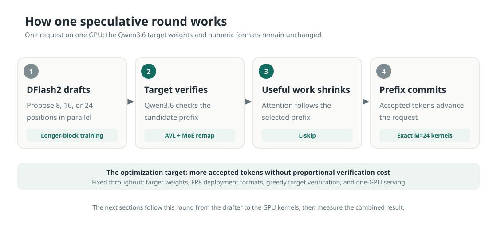
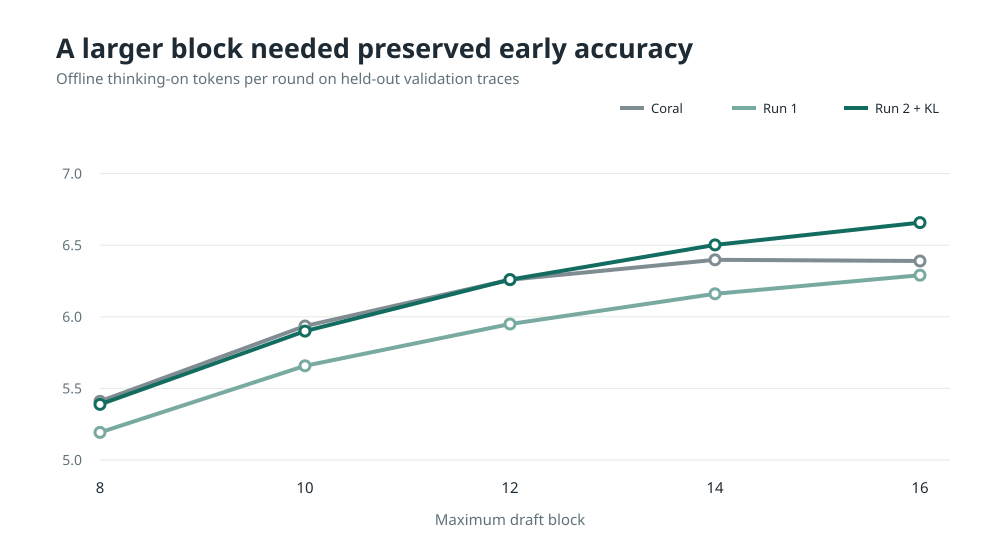
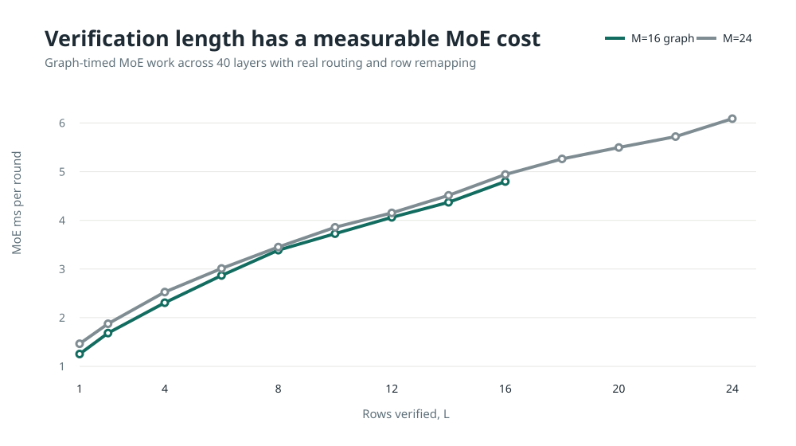
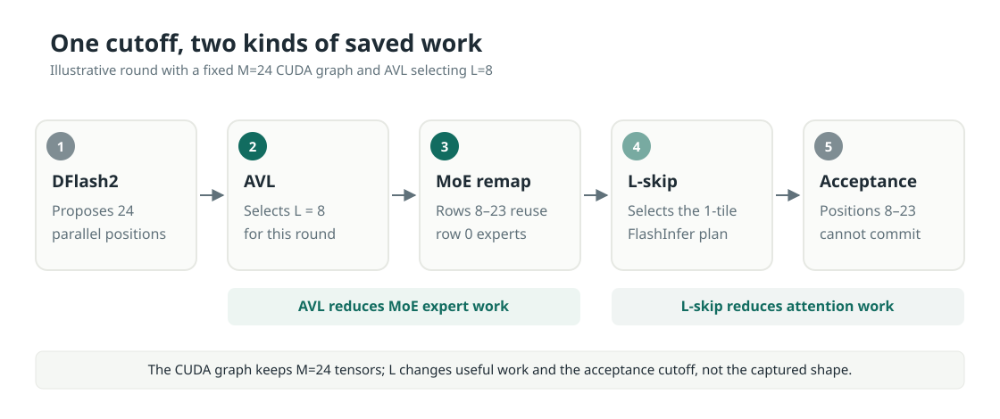
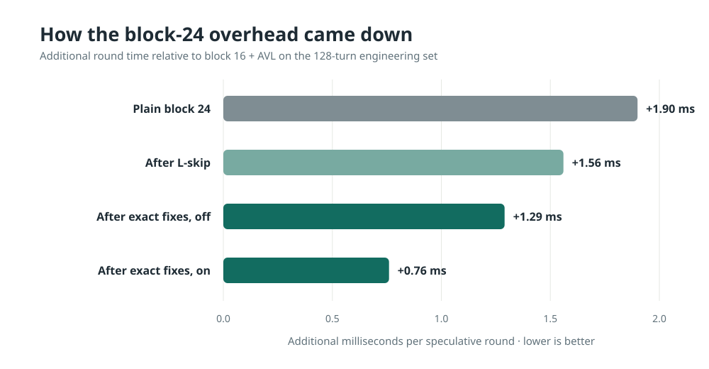
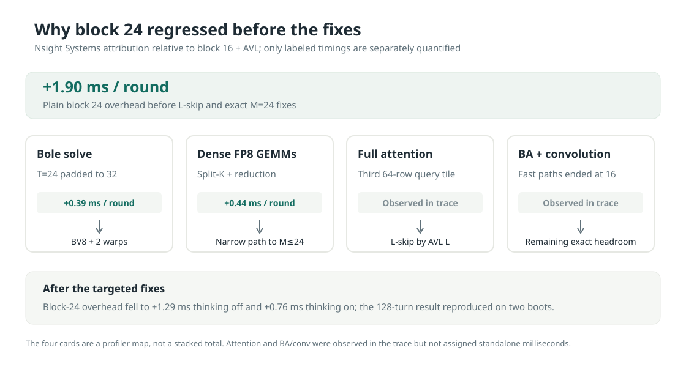
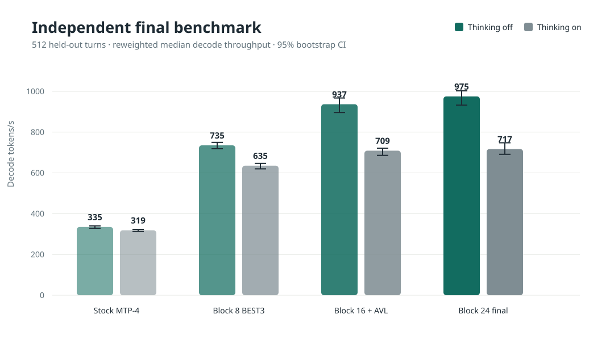
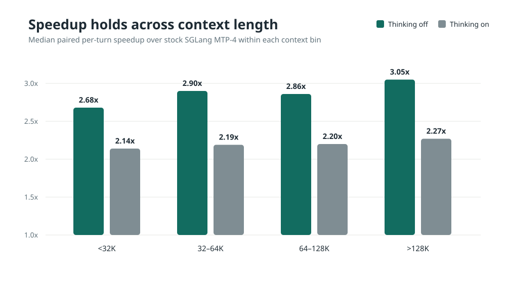

I wanted to maximize correct, single-request decode speed for Qwen3.6-35B-A3B-FP8 on one GPU. I kept the target model's weights and numeric formats unchanged. The path went from stock SGLang at **335 tok/s with thinking off** and **319 tok/s with thinking on**, to **975 and 717 tok/s** on a separate 512-turn benchmark. That is **2.91x and 2.25x** the stock throughput. <span class="tag meas">Measured</span>

The engineering challenge was to accept more draft tokens without making target verification proportionally more expensive. I extended Coral's DFlash2 work with teacher-guided longer-block training, cost-aware verification, FlashInfer plan selection, and exact block-24 kernel fixes. The target remained in its existing FP8 representation throughout. [Jump to the final benchmark](#final-independent-benchmark), or follow the profiling decisions that produced it.

<div class="stat-grid">
<div class="stat"><p class="stat-num">975 tok/s</p><p class="stat-label">Thinking off · 335 to 975 tok/s<br><strong>2.91x stock throughput</strong></p></div>
<div class="stat"><p class="stat-num">717 tok/s</p><p class="stat-label">Thinking on · 319 to 717 tok/s<br><strong>2.25x stock throughput</strong></p></div>
<div class="stat"><p class="stat-num">12.15 accepted tok/round</p><p class="stat-label">Thinking off<br><strong>from 4.62 on stock</strong></p></div>
</div>

<div class="callout key-highlights">
<p><strong>Key highlights</strong></p>
<ul>
<li>Fine-tuned the DFlash2 drafter from 8 to 24 parallel positions while preserving its useful early-position distribution.</li>
<li>Built AVL to choose verification length from draft confidence and measured MoE cost.</li>
<li>Made FlashInfer attention follow that choice with L-skip, then tuned the exact M=24 execution paths exposed by profiling.</li>
<li>Kept the target weights and numeric formats unchanged, isolating the throughput headroom in execution.</li>
</ul>
</div>

<div class="definition-grid">
<div class="definition-card"><p><strong><a href="#adaptive-verification-length">AVL</a></strong> selects a useful verification prefix from draft confidence and measured MoE cost, then remaps unused rows so they do not load additional expert weights.</p></div>
<div class="definition-card"><p><strong><a href="#attention-and-l-skip">L-skip</a></strong> selects the shorter FlashInfer plan for that prefix, so attention does not execute query tiles that acceptance cannot use.</p></div>
</div>

<div class="top-table">

| Configuration | Thinking off | Thinking on | Accepted tokens per round, off / on | Throughput vs stock, off / on |
|---|---:|---:|---:|---:|
| Stock SGLang MTP-4 | 335 tok/s | 319 tok/s | 4.62 / 4.33 | 1.00x / 1.00x |
| Block 8, BEST3 | 735 tok/s | 635 tok/s | 6.53 / 5.70 | 2.20x / 1.99x |
| Block 16 + AVL | 937 tok/s | 709 tok/s | 10.08 / 7.57 | 2.80x / 2.23x |
| **Block 24 + AVL + L-skip + exact fixes** | **975 tok/s** | **717 tok/s** | **12.15 / 8.55** | **2.91x / 2.25x** |

</div>

<p class="result-scope"><strong>Scope:</strong> batch size 1, greedy decoding, one RTX PRO 6000 Blackwell Server Edition, SGLang 0.5.21, and 512 independent held-out MLCommons agentic-coding turns. Throughput is the context-bin-reweighted median. The final comparisons use the same turns on the same boot, with trace-clustered bootstrap 95% confidence intervals. <span class="tag meas">Measured</span> <a class="result-link" href="#final-independent-benchmark">See the complete result</a></p>

<div class="evidence-key">
<p><span class="tag meas">Measured</span> Recorded by a benchmark, profiler, or correctness test</p>
<p><span class="tag est">Estimate</span> Derived from measured inputs with the assumption stated nearby</p>
<p><span class="tag theo">Theoretical</span> A bound, model, or design principle rather than an observed result</p>
</div>

{{toc}}

## 1. Goal and constraints {#the-goal}

My objective was to maximize single-request decode throughput while preserving Qwen3.6's target weights and numeric formats. I had SGLang's CUDA-graph serving stack, Coral's block-diffusion drafter, and a hybrid MoE and attention target. The core tradeoff was simple: a longer draft can commit more tokens per target pass, but every extra row also increases verification work.

In this article, block size is the maximum number of positions DFlash2 proposes in parallel. The verify step is the target pass that checks them, and accepted tokens per round is the prefix the target keeps before the next draft.

I set engineering targets of at least 1,000 tok/s with thinking off and 700 tok/s with thinking on, measured on agentic-coding turns rather than short synthetic prompts. <span class="tag meas">Measured target</span>

Coral's DFlash2 drafter predicts a block of positions in parallel and uses a selector lattice to choose a consistent candidate path. I started from Coral's block-8 checkpoint and its published [Qwen3.6 agent-serving study](https://www.coralbricks.ai/blog/speculative-decoding-qwen36). Coral reported 1.93x with thinking off and 1.70x with thinking on over its own stock baseline on an H100. Their result established the research direction; my measurements use different hardware, data splits, and an independent baseline, so I treat them as context rather than a controlled head-to-head comparison. <span class="tag meas">Published context</span>

Preserving the target kept its existing FP8 deployment configuration intact and made execution efficiency the independent variable. I could measure how much headroom came from drafting, verification, kernels, and orchestration before considering a different target representation. Different GPU execution shapes can still change rounding at near-tied logits, so unchanged weights and formats do not imply bit-identical text. I quantify that boundary in [Correctness](#correctness).

<figure class="wide-flow">

<figcaption>{{figure:system-overview}} The system-level view of one speculative round. I kept the target representation fixed and optimized the work around verification: drafting, MoE routing, attention planning, and the exact block-24 kernel paths. <span class="tag theo">Overview</span></figcaption>
</figure>

<p class="read-guide"><strong>Read this figure from left to right:</strong> DFlash2 proposes several future positions at once. The unchanged target verifies them. AVL limits useful MoE work, L-skip limits attention work, and only the target-approved prefix advances the request. The rest of the article explains how profiling led to each change.</p>

## 2. Starting point {#what-i-started-with}

I began the early serving experiments on an NVIDIA L4, then moved the full Qwen3.6 study to one NVIDIA RTX PRO 6000 Blackwell Server Edition on AWS. The final GPU had 96 GB of memory, 188 streaming multiprocessors, and about 1.6 TB/s of memory bandwidth. <span class="tag meas">Measured setup</span>

| Component | Configuration |
|---|---|
| Target | Qwen3.6-35B-A3B-FP8, FP8 weights and FP8 KV cache |
| Architecture | 30 Gated-DeltaNet layers and 10 full-attention layers |
| Attention | 16 query heads, 2 key/value heads, head dimension 256 |
| Mixture of experts | 256 experts, top-8 routing |
| Server | SGLang 0.5.21, FlashInfer attention, CUDA graphs, custom hook module |
| Drafter | Fine-tuned Coral DFlash2, 6 layers; released checkpoint trained at block size 8 |
| Workload | MLCommons agentic-coding traces, BS1 greedy, up to 1,024 output tokens |

{{table:setup}} Experiment configuration. A mixture of experts, or MoE, routes each token row through only a subset of the model's experts. <span class="tag meas">Measured setup</span>

The model is hybrid. Most layers use Gated DeltaNet, a recurrent linear-attention mechanism that carries state forward. Ten layers use full attention over the key/value cache. Speculative verification therefore has to manage both recurrent state and attention cache while routing each verified row through a mixture of experts.

Earlier work had already produced the exact optimized [BEST3 serving baseline](https://github.com/ravi-kot/sglang-speculative-decoding-optimization/tree/main/experiments/qwen36-speculative-decoding/code/q36). It included a backport of [Bole](https://arxiv.org/abs/2608.01651) for linear-attention state, based on [SGLang pull request 46702](https://github.com/sgl-project/sglang/pull/46702); sync-free attention planning; narrow-tile FP8 matrix multiplications; an `in_proj_ba` kernel bitwise equal to stock; a 48K hot draft vocabulary; and an 8K drafter context window. <span class="tag meas">Measured baseline</span>

In the measurements below, batch size 1, or BS1, means one active request. Greedy decoding chooses the target's highest-scoring next token. Thinking off and thinking on are the model's two response modes; thinking on includes its reasoning segment before the tool-facing answer. Each benchmark configuration fixes the checkpoint, hook settings, kernels, and serving flags.

## 3. Experimental setup and measurement {#measurement}

The prompts came from MLCommons agentic-coding traces. They are histories from coding-agent sessions, including long context and tool traffic. I split them into four context bins: shorter than 32K tokens, 32K to 64K, 64K to 128K, and longer than 128K. <span class="tag meas">Measured dataset</span>

Raw workload frequency is uneven across those bins. I therefore use a reweighted median: compute the distribution while restoring the original MLCommons bin weights of 2,614, 2,272, 5,852, and 5,039. Turns with fewer than 32 output tokens are excluded. This prevents one test sample's context mix from deciding the headline number. <span class="tag meas">Measured method</span>

Every engineering comparison used paired turns and a control rerun on the same boot. A paired comparison means that both configurations see the same requests. Confidence intervals come from 2,000 trace-clustered bootstrap replicates; clustering keeps turns from one underlying trace together when resampling. <span class="tag meas">Measured method</span>

I used two datasets for two different jobs:

- `turns_hold128.jsonl` has 128 turns, 32 per context bin. I used it to choose configurations.
- `turns_bench.jsonl` has 512 independent turns, 128 per bin, drawn from 45 sessions not used for training or checkpoint selection. I used it once for the final benchmark.

<span class="tag meas">Measured split</span>

This separation became important because my first supposedly independent turn set shared traces with the training data. I discarded it, rebuilt the 128-turn engineering set, and later built the disjoint 512-turn final set. That cost time, but it removed a much larger credibility problem.

For each configuration I stored decode throughput, accepted tokens per round, round time, per-context results, and output text. Nsight Systems gave me the GPU critical path. Isolated kernel gates checked latency and numeric differences before a kernel was allowed into the server.

## 4. Why block 8 was the ceiling {#block-size-ceiling}

The block-8 drafter was frequently using all the room available. In a thinking-on run, 35% of speculative rounds accepted every token the block allowed. Once that happens, better predictions cannot produce more accepted tokens without increasing the block itself. <span class="tag meas">Measured</span>

The released checkpoint had been trained at block size 8. Positions 9 through 16 were untrained. Simply asking for a larger block would test whether the model happened to extrapolate, not whether it had learned those positions.

My first fine-tune, Run 1, extended training to block 16 at a learning rate of 1e-4. It learned the new positions, but accuracy at positions 1 through 7 decreased. Thinking-on acceptance did not improve enough. <span class="tag meas">Measured</span>

That failure changed the objective. I needed to preserve the part of the drafter that already worked while teaching only the extra span. Run 2 used a frozen block-8 teacher and added a KL-divergence term over positions 1 through 7 in the [fine-tuning pipeline](https://github.com/ravi-kot/sglang-speculative-decoding-optimization/blob/main/experiments/qwen36-speculative-decoding/code/q36/ft2_train.py). The learning rate was reduced to 3e-5. The KL term encourages the new drafter's probability distribution to remain close to the teacher where the teacher is already useful.

| Drafter | Block 8, off / on | Block 14, off / on | Block 16, off / on |
|---|---:|---:|---:|
| Coral released drafter | 6.58 / 5.41 | 8.44 / 6.40 | 8.39 / 6.39 |
| Run 1 | 6.44 / 5.19 | 8.66 / 6.16 | 9.21 / 6.29 |
| **Run 2, teacher KL** | **6.57 / 5.39** | **8.96 / 6.50** | **9.53 / 6.66** |

{{table:drafter-sweep}} Offline accepted tokens per round on held-out validation traces. The KL run preserved the early block while learning the later positions. <span class="tag meas">Measured</span>

<figure>

<figcaption>{{figure:drafter-blocks}} The released block-8 checkpoint is the starting point; the two lines show how my fine-tuning recipes behaved as the maximum block grew. Run 2 retained early-position accuracy while learning the added positions.</figcaption>
</figure>

Coral published its broader server study on an H100. The 6.58 / 5.41 values in the table are my local offline evaluation of its released drafter, while the server throughput results in this article come from the RTX PRO 6000 setup above. This keeps the published work as research context without treating different hardware and methods as a controlled comparison.

The offline result justified a server test. Block 16 improved thinking-off throughput by 25%, but thinking-on was initially flat or negative because target verification became 2.2 ms more expensive per round. Acceptance had improved; verification cost had become the next bottleneck. <span class="tag meas">Measured</span>

That observation set the next experiment: retain the longer draft, but avoid paying for all 16 rows when the tail was unlikely to survive.

## 5. Why block 16 cost more {#larger-verify-cost}

Nsight Systems split the extra time into two mechanisms.

First, the MoE layers saw more token rows. Each row can route to a different set of eight experts. As the number of distinct experts grows, the GPU must read more expert weights. The target still reuses weights across rows, but the reuse is not free when the routing set expands.

Second, full attention changed shape. At head dimension 256, FlashInfer processes the queries in 64-row tiles. The block-16 verify produced a second query tile. Its L2 hit rate increased from 10.5% to 50%, while DRAM traffic stayed near 65 MB at the 101K-context profile. That told me the second tile was reusing cached data. Its cost came from per-thread-block latency, not repeated DRAM traffic. <span class="tag meas">Measured</span>

The profile separated two decisions. MoE needed fewer useful rows so it would load fewer distinct expert weights. Attention needed fewer executed query tiles. The first led to AVL; the second later led to [L-skip](#attention-and-l-skip).

## 6. AVL: reducing MoE work {#adaptive-verification-length}

Adaptive verification length, or AVL, chooses a useful draft prefix for each round. The general idea of dynamic speculation is established. My question was narrower: could the choice explicitly price this model's measured MoE work while retaining a fixed CUDA graph shape?

For each candidate length `L`, I used the drafter's calibrated path confidence to estimate the number of useful accepted tokens. I subtracted a penalty based on the measured MoE cost curve:

```text
score(L) = expected accepted tokens at L - lambda * measured MoE milliseconds at L
```

The default penalty used `lambda = 0.75`, with a minimum verification length of 2. I tested a minimum of 4 and a penalty of 0.5; neither beat the default. <span class="tag meas">Measured</span>

| Verify length L | MoE ms per round, M=16 | MoE ms per round, M=24 |
|---:|---:|---:|
| 1 | 1.253 | 1.465 |
| 4 | 2.308 | 2.526 |
| 8 | 3.387 | 3.452 |
| 12 | 4.062 | 4.154 |
| 16 | 4.798 | 4.942 |
| 20 | not measured | 5.496 |
| 24 | not measured | 6.089 |

{{table:moe-cost}} Graph-timed MoE cost across all 40 target layers with real routing. M is the fixed graph row count; L is the selected useful length. <span class="tag meas">Measured</span>

<figure>

<figcaption>{{figure:avl-cost}} The measured cost curve used by AVL</figcaption>
</figure>

The graph still has a fixed 16-row or 24-row tensor shape. In the [serving hook](https://github.com/ravi-kot/sglang-speculative-decoding-optimization/blob/main/experiments/qwen36-speculative-decoding/code/q36/q37_nvtx.py), rows at or beyond `L` are remapped to row 0's experts, so they introduce no new expert-weight loads. Drafts at or beyond `L` are masked before acceptance. A small device-side operation makes the choice without a host synchronization. The measured AVL overhead was about 0.08 ms per round. <span class="tag meas">Measured</span>

<figure class="wide-flow">

<figcaption>{{figure:avl-lskip}} AVL and L-skip act on the same cutoff but remove different work: AVL limits new MoE expert loads, while L-skip removes attention tiles. L=8 is an illustrative round; the underlying graph remains M=24. <span class="tag theo">Illustrative</span></figcaption>
</figure>

On the 128-turn engineering set, AVL improved block 16 by 4.2% with thinking off and 8.6% with thinking on using paired geometric means. The thinking-on reweighted median reached 691 tok/s, compared with 631 tok/s for block-8 BEST3. <span class="tag meas">Measured, same turns and boot</span>

Dynamic speculation is established work. My implementation combines path confidence, a measured MoE cost curve, and expert-row remapping inside a fixed-shape graph; I have not found that exact combination in the prior work I reviewed.

## 7. Understanding the drafter {#drafter-training}

AVL reduced the cost of uncertain tails. I next tested whether better data or a different training objective could make those tails accurate enough to keep. The following runs changed the drafter while leaving the serving path controlled.

| Training run | Change from Run 2 | Offline off / on tokens per round | Server result |
|---|---|---:|---|
| Run 3a | Hard post-rejection anchors | 9.52 / 6.64 | Not kept |
| Run 3b | Add 120 Workato traces | 9.49 / 6.66 | Not kept |
| Run 4 | Add 140 SWE-rebench-OpenHands trajectories | 9.57 / 6.65 | Not kept |
| Run 5c | Confidence-weighted loss | 9.60 / 6.64 | 0.9998 paired median ratio |

{{table:drafter-training}} Additional training recipes on held-out validation traces. The new data used target-generated features and labels; the SWE trajectories were CC-BY-4.0, one per repository, with evaluation repositories excluded. <span class="tag meas">Measured</span>

The near-identical averages could have meant that the drafter lacked capacity. An overfitting probe showed that capacity was available: it could memorize four traces and gain 1.9 accepted tokens per round with thinking off and 1.4 with thinking on, while held-out performance dropped. <span class="tag meas">Measured</span>

The miss pattern gave a more useful answer. Of the misses, 47% occurred on tokens for which the target itself assigned at least 90% confidence. The miss rate on those target-confident tokens rose from 2.6% at draft position 1 to about 6% by position 5. A block-diffusion drafter predicts positions in parallel, so a later position cannot condition on the actual earlier token chosen in that same draft. Errors accumulate along the proposed path even when the target is locally confident. <span class="tag meas">Measured</span>

Widening the drafter window from 8K to 16K or 32K did not help. Only 0.36% of thinking-on reasoning tokens fell outside the 48K draft vocabulary. The evidence pointed away from missing context, vocabulary coverage, or one particular loss. It pointed to per-position accuracy in parallel drafting at this scale. <span class="tag meas">Measured</span>

Those diagnostics redirected the work from another training recipe to the execution cost of the accepted prefix.

## 8. L-skip: reducing attention work {#attention-and-l-skip}

My first attention experiment attempted to remove the extra 64-row tile entirely. I wrote a [Triton split-KV kernel](https://github.com/ravi-kot/sglang-speculative-decoding-optimization/blob/main/experiments/qwen36-speculative-decoding/code/q36/attn128.py) that handled all 16 token rows and eight grouped-query heads with one thread block per KV head. It was numerically correct within the recorded tolerance.

Profiling showed that FlashInfer's existing CUDA mapping was faster. At 101K context, FlashInfer took about 130 microseconds per layer while my kernel took about 263 microseconds for the full 16-row case. Across the long-context cases, it was roughly 1.5x to 2x faster than my mapping because shared-memory and register limits constrained the Triton kernel. <span class="tag meas">Measured</span>

I retained FlashInfer's optimized kernel and focused on reducing how many query tiles it executed.

[AVL](#adaptive-verification-length) already knew `L`. Each round I prepared variants that covered only the first one, two, or three query tiles, using a finer KV split. Inside the CUDA graph, a tiny device-side copy in the [serving hook](https://github.com/ravi-kot/sglang-speculative-decoding-optimization/blob/main/experiments/qwen36-speculative-decoding/code/q36/q37_nvtx.py) selects the plan for the current `L`. Skipped tiles merge to exact zeros and are never consumed. I call this L-skip.

| Context | Block 16 full / L-skip | Block 24 full / keep 1 tile | Block 24 full / keep 2 tiles |
|---:|---:|---:|---:|
| 18K | 37.5 / 29.7 us | 43.5 / 30.4 us | 43.5 / 37.5 us |
| 48K | 73.6 / 56.2 us | 99.3 / 57.7 us | 99.3 / 75.1 us |
| 101K | 123.0 / 93.3 us | 181.0 / 92.8 us | 181.0 / 121.8 us |
| 165K | 204.2 / 149.9 us | 300.3 / 149.9 us | 300.3 / 204.2 us |

{{table:lskip}} Isolated FlashInfer plan-variant gate from session 15. Repeated session-16 measurements are included in `data/gates.csv`. <span class="tag meas">Measured</span>

The server gain was about 1% paired. That is smaller than the isolated kernel change because attention is only one part of a full round. <span class="tag meas">Measured, same turns and boot</span>

Integration produced a less obvious failure. SGLang captures the verification graph using the real `plan()` call and only uses the fast path during replay. FlashInfer aliases `begin_forward` to `plan`. Patching `plan` alone therefore missed one call path. Fixing both names made the isolated result appear in the captured server path.

## 9. Making block 24 efficient {#block-24}

Block 16 eventually showed the same ceiling as block 8: 12.3% of rounds still accepted all 16 available tokens. <span class="tag meas">Measured</span>

I evaluated the Run 2 checkpoint at block 24 before training positions 17 through 24. It already reached 10.22 accepted tokens per round with thinking off and 6.80 with thinking on. That surprised me. The drafter had learned enough structure in the first 16 positions that a longer selector path still found useful continuations. <span class="tag meas">Measured</span>

Run 6 then trained at block 24 with a KL teacher from Run 2 at block 16. It reached 10.51 and 6.91 tokens per round, including the first clear improvement on the thinking-on reasoning segment: 5.44 instead of 5.19. Continuing the recipe in Run 6c produced 10.49 and 6.92, so I stopped training. <span class="tag meas">Measured</span>

The first server integration reduced throughput. Compared with block 16 + AVL, block 24 was 1.2% slower with thinking off and 6% slower with thinking on. The round was 1.9 ms longer. The additional accepted tokens were not yet paying for the new execution shape. <span class="tag meas">Measured, same turns and boot</span>

<figure>

<figcaption>{{figure:block24-overhead}} The measured progression from the initial block-24 regression to the final execution path. Each bar is additional round time relative to block 16 + AVL; shorter is better. <span class="tag meas">Measured</span></figcaption>
</figure>

<p class="read-guide"><strong>Read this figure from top to bottom:</strong> the longer block initially added 1.90 ms per round. L-skip recovered attention work first. The exact M=24 GEMM and Bole paths then reduced the remaining overhead, with the final value depending on the model's response mode.</p>

<figure class="wide-flow">

<figcaption>{{figure:block24-profile}} Nsight Systems turned the block-24 regression into four targeted causes. Only Bole and split-K were separately timed; the attention and fallback boxes are trace observations, not an additive timing breakdown. <span class="tag meas">Measured + trace</span></figcaption>
</figure>

Nsight Systems showed why:

- Bole padded the 24-token block to 32, adding 0.39 ms per round.
- Stock FP8 dense GEMMs switched to a split-K path with a reduction at M=24, adding 0.44 ms.
- Full attention acquired a third query tile.
- `in_proj_ba`, convolution, and other small paths crossed their 16-row fast-path limits.

<span class="tag meas">Measured</span>

I addressed each measured cause with the smallest compatible change. [L-skip](#attention-and-l-skip) handled the third attention tile when AVL chose a shorter `L`. I extended the [narrow dense FP8 GEMM path](https://github.com/ravi-kot/sglang-speculative-decoding-optimization/blob/main/experiments/qwen36-speculative-decoding/code/q36/s5_dense_exact.py) through M=24 and verified bitwise equality to stock for M from 1 through 24. For [Bole's solve kernel](https://github.com/ravi-kot/sglang-speculative-decoding-optimization/blob/main/experiments/qwen36-speculative-decoding/code/g7e/bole_repro2.py), a V tile of 8 and two warps reduced one-layer graph latency from 27.68 to 21.62 microseconds at T=24, again bitwise equal. <span class="tag meas">Measured</span>

The block-24 overhead fell from 1.90 ms to 1.56 ms with L-skip, then to 1.29 ms with thinking off and 0.76 ms with thinking on after the exact fixes. On two separate boots, the best stack reached about 934 tok/s off and 702.5 tok/s on over the 128-turn engineering set. <span class="tag meas">Measured, same-turn paired reproductions</span>

Block 24 became useful after the execution path treated 24 rows as a tuned shape rather than a collection of fallbacks. That completed the causal chain from longer drafts to cost-aware verification, attention planning, and shape-specific kernel work.

## 10. Experiments that informed the design {#experiments-not-kept}

The configurations below remained outside the final stack, but each one narrowed the next decision.

| Experiment | Hypothesis | Result | Mechanism or lesson |
|---|---|---|---|
| Run 1 block-16 fine-tune | Training later positions would extend acceptance | Later positions improved, early positions regressed | New training erased part of the useful block-8 distribution; teacher KL was needed |
| Hard rejection anchors | Emphasizing post-rejection tokens would repair the path | 9.52 / 6.64 offline | The loss was not the main limiter |
| More Workato and SWE data | More domain data would improve reasoning acceptance | At most 9.57 / 6.66 offline | The drafter could memorize, but the held-out path stayed limited |
| Confidence-weighted loss | Target-confidence weighting would focus on avoidable misses | Server paired ratio 0.9998 | A slightly better offline score did not translate into serving throughput |
| 16K and 32K draft windows | More raw context would reduce misses | Worse than the 8K window | Context reach was not the active constraint |
| Custom Triton attention | One 128-row mapping would avoid multiple query tiles | 262.6 us vs 130.2 us at 101K | FlashInfer's CUDA mapping used the GPU resources more effectively, so I retained it and reduced executed tiles |
| Plain block 24 | More accepted tokens would outweigh verification | 1.2% lower off and 6% lower on | Bole padding, split-K GEMMs, a third attention tile, and row-count fallbacks consumed the acceptance gain |
| Run 6c continued training | More block-24 training would keep raising acceptance | 10.49 / 6.92 vs 10.51 / 6.91 | The recipe had saturated |

{{table:negative-results}} Experiments excluded from the final stack and the evidence that determined the next action. <span class="tag meas">Measured</span>

One run deserves an operational note. A correctness script queried the live server during the end of a thinking-on benchmark and stalled those turns. I excluded that contaminated number instead of explaining it away. A separate training run hung on a truncated feature file; the loader now skips unreadable files.

## 11. Final results: 975 tok/s {#final-independent-benchmark}

After the engineering stop, I ran every final configuration sequentially on one boot over the 512-turn disjoint set. No turn in this set had been used for training, checkpoint selection, or configuration choice.

<figure>

<figcaption>{{figure:final-throughput}} The independent benchmark separates the early block-8 result from the final block-24 stack; error bars show the trace-clustered 95% confidence interval.</figcaption>
</figure>

| Configuration | Off tok/s, 95% CI | On tok/s, 95% CI | Off vs stock | On vs stock |
|---|---:|---:|---:|---:|
| Stock SGLang MTP-4 | 335, 329 to 340 | 319, 313 to 323 | 1.00x | 1.00x |
| Block 8, BEST3, Coral drafter | 735, 718 to 750 | 635, 620 to 647 | 2.20x, 2.14 to 2.25 | 1.99x, 1.96 to 2.03 |
| Block 16 + AVL, Run 2 | 937, 896 to 968 | 709, 686 to 721 | 2.80x, 2.70 to 2.87 | 2.23x, 2.17 to 2.27 |
| **Block 24 + AVL + L-skip + exact fixes, Run 6** | **975, 932 to 1,003** | **717, 691 to 748** | **2.91x, 2.81 to 2.99** | **2.25x, 2.19 to 2.34** |

{{table:final-results}} Reweighted median decode throughput. Confidence intervals use trace-clustered bootstrap resampling. <span class="tag meas">Measured, same turns and boot</span>

The thinking-on target of 700 tok/s was reached. The thinking-off headline reweighted median was 975 tok/s, below the 1,000 tok/s target. The unweighted all-turn median was 1,001 tok/s, and the shortest-context bin reached about 1,068 tok/s. I report the reweighted 975 tok/s as the headline because it preserves the intended workload mix. <span class="tag meas">Measured</span>

<figure>

<figcaption>{{figure:context-speedup}} The final stack remains above 2x stock throughput in both response modes across all four context bins.</figcaption>
</figure>

| Context length | Thinking off | Thinking on |
|---|---:|---:|
| Under 32K | 2.68x | 2.14x |
| 32K to 64K | 2.90x | 2.19x |
| 64K to 128K | 2.86x | 2.20x |
| Over 128K | 3.05x | 2.27x |

{{table:context-speedup}} Median paired per-turn speedup over stock within each context bin. <span class="tag meas">Measured, same turns and boot</span>

The result is not coming from one favorable prompt range. It remains above 2x in both response modes and all four context bins. The larger thinking-off gain is consistent with its higher acceptance: 12.15 tokens per round, compared with 8.55 when thinking is on. <span class="tag meas">Measured</span>

## 12. Where the gains came from {#ablation}

The independent benchmark is a cumulative progression, not a perfect factorial ablation. Each row changes both the drafter and parts of the serving stack. The paired engineering set supplies the narrower comparisons.

| Change | Comparison | Thinking off | Thinking on | What moved |
|---|---|---:|---:|---|
| BEST3 + Coral DFlash2 | Block 8 vs stock, final set | 2.20x | 1.99x | Cheaper block drafting and the earlier exact serving stack |
| Run 2 block 16 + AVL | vs block 8, final set | 1.274x | 1.116x | More accepted tokens plus cost-aware verify length |
| AVL alone | block 16 AVL vs block 16, hold128 | 1.042x geo | 1.086x geo | Less MoE and attention work on low-confidence tails |
| L-skip alone | block 16 + AVL, hold128 | 1.016x geo | 1.004x geo | Fewer FlashInfer query tiles when `L` is short |
| Block 24 + all exact fixes | vs block 16 + AVL, final set | 1.041x | 1.011x | More accepted tokens after removing M=24 fallbacks |

{{table:ablation}} Cumulative final-set steps and narrower same-boot engineering comparisons. <span class="tag meas">Measured</span>

The final increment is small compared with the jump from stock. That is expected. Block 24 accepts more tokens, but also performs a larger verify. The exact fixes make the trade favorable; they do not remove the cost.

## 13. Decision summary {#mechanisms}

| Technique | Hypothesis | Result | Mechanism |
|---|---|---|---|
| Teacher KL at block 16 | Preserve early accuracy while learning later positions | Kept block-8 behavior and improved block-16 acceptance | The frozen teacher constrained positions 1 through 7 |
| AVL | Do not pay full MoE cost when the draft tail is unlikely to survive | +4.2% off and +8.6% on, paired geometric mean | Confidence chose `L`; remapping prevented unused rows from loading new expert weights |
| Extra training recipes | Better data or loss would repair misses | Offline and server results stayed flat | Misses grew by draft position; parallel positions cannot observe earlier sampled tokens |
| Custom Triton attention | One larger query mapping would beat multiple FlashInfer tiles | 262.6 us vs 130.2 us at 101K | Resource pressure outweighed the tile-count advantage |
| L-skip | Keep FlashInfer but omit query tiles beyond AVL's `L` | Faster isolated attention and about +1% server | It preserved the tuned CUDA kernel and changed only the plan |
| Block 24 | Longer proposals would increase useful work per target pass | Won only after exact fixes | Acceptance rose, but Bole padding, split-K GEMMs and fallbacks first consumed the gain |

{{table:mechanisms}} The experiment logic in one view. <span class="tag meas">Measured</span>

## 14. What I built and reused {#ownership}

Speculative decoding, adaptive draft length, block diffusion, FlashInfer, Bole, and SGLang are established work. The result depends on all of them. I separate the upstream foundation from the training, policy, integration, and kernel work I added.

| Category | Part of this stack |
|---|---|
| Upstream or published | SGLang 0.5.21; FlashInfer attention; Coral's DFlash2 checkpoint and selector design; Bole's recurrent-state method and SGLang integration |
| Earlier work I adapted | Bole backport, sync-free planning, narrow FP8 GEMMs, exact `in_proj_ba`, 48K draft vocabulary, 8K draft context |
| Built in this campaign | Run 2 and Run 6 training recipes; AVL's measured MoE objective and expert-row remapping; L-skip plan selection; M=24 dense extension; Bole tile/warp tuning; paired benchmark and correctness harness |
| Not changed | Qwen3.6 target weights and formats; FP8 target; greedy acceptance rule |

{{table:ownership}} Provenance of the final stack. The external work is linked in [Evidence, code and references](#evidence-code-and-references).

Adaptive verification length builds on established dynamic speculation. My contribution is the combination of measured MoE cost, expert-row remapping, and fixed-graph device selection. L-skip is a focused integration technique that selects among FlashInfer plans instead of replacing its kernel.

## 15. Correctness {#correctness}

Speculative decoding should preserve the target distribution in exact arithmetic. Real GPU kernels do not operate in exact arithmetic. A different verify shape changes reduction order, and near-tied logits can swap their top token.

I compared each configuration with target-only greedy decoding on 64 held-out turns per mode. "Identical" means the full generated output matched. The final block-24 configuration matched 50 of 64 thinking-off outputs and 31 of 64 thinking-on outputs. Stock MTP-4 matched 44 of 64 off; its thinking-on run was partial at 18 of 34. Every tested configuration produced zero malformed tool calls. <span class="tag meas">Measured</span>

| Configuration | Off identical | On identical | Malformed tool calls |
|---|---:|---:|---:|
| Stock MTP-4 | 44 / 64 | 18 / 34, partial | 0 |
| Block 16 + AVL | 46 / 64 | 31 / 64 | 0 |
| Block 24 final | 50 / 64 | 31 / 64 | 0 |

{{table:correctness}} Agreement with target-only greedy decoding on the hold128 correctness subset. <span class="tag meas">Measured</span>

At the first divergence, the median target logit margin was 0.125 nats in the recorded thinking-on comparisons. The target's own prefill could choose either near-tied token depending on shape. This is not bit identity, and I do not describe it as such. It is also not evidence that the final configuration is less faithful than stock on this test. <span class="tag meas">Measured</span>

The 512-turn benchmark stores output text, but I did not run target-only correctness over all 512 turns. I therefore keep the throughput and correctness claims separate.

## 16. Remaining headroom {#stopping-rule}

The remaining exact changes were a native 24-row Bole kernel, 24-row `in_proj_ba` and convolution paths, and work focused on the 32K to 64K context bin. From the measured kernel costs, I estimated 3% to 5% total headroom. <span class="tag est">Estimate</span>

A 1,300-token-per-second result would require a larger reduction in bytes moved, such as FP4 experts or a lower-precision target head. Those changes violated the experiment's exact-target boundary, so I did not use them. <span class="tag est">Estimate from measured byte costs</span>

My engineering stop rule was triggered when the reproduced best configuration remained below 960 tok/s on the 128-turn set. It reproduced at 934 tok/s off and 702.5 tok/s on, so I stopped tuning and ran the independent benchmark. <span class="tag meas">Measured</span>

The next experiments follow directly from the remaining evidence:

1. Can a drafter architecture reduce the position-dependent confident misses while staying parallel?
2. Can the remaining native M=24 paths recover the estimated 3% to 5% without changing target numerics?
3. Does AVL's policy transfer to other MoE routing distributions and GPUs when its cost curve is remeasured?

## 17. Lessons {#lessons}

**A full block is evidence.** If many rounds accept every available token, the current block is censoring the acceptance distribution. Measure that before changing the loss.

**Preserve the part that works.** Run 1 learned new positions and damaged old ones. The teacher constraint made the larger block useful.

**Price verification as well as drafting.** Block 16 initially gained acceptance while serving speed fell. AVL worked because its objective included measured target cost.

**A correct custom kernel can still be the wrong kernel.** My Triton attention mapping was intuitive and slower. Keeping FlashInfer and changing its plan was the smaller, better intervention.

**Profile the new shape.** Block 24 crossed several hidden thresholds at once. The profiler turned a general regression into Bole padding, split-K reduction, a third attention tile, and small-kernel fallbacks.

**Keep selection and evaluation disjoint.** The 128-turn set chose the stack. The 512-turn set judged it.

## 18. Methodology {#methodology-notes}

The final benchmark used a single boot from November 11, 2026, with the stock, block-8, block-16, and block-24 configurations run sequentially. The set contained 128 turns in each of four context bins. The raw number of usable thinking-off turns differed slightly by configuration because turns with fewer than 32 generated tokens were excluded; thinking-on retained all 512. <span class="tag meas">Measured</span>

I made and caught several process mistakes:

- The first independent set overlapped training traces. I rebuilt it and did not use it for the final claim.
- A replay tool silently resumed from an old result file, so its control had not been rerun. I discarded that comparison.
- A correctness script queried a live server during a benchmark and stalled the final thinking-on turns. I excluded that contaminated result.
- A truncated feature file hung training. The loader was changed to skip unreadable files.
- An on-instance shutdown guard limited each GPU session, so experiments were designed to fit roughly 2.5-hour boots.

<span class="tag meas">Recorded process</span>

The headline statistic is decode throughput in tok/s, not time to first token or end-to-end request latency. TTFT exists in the raw replay files but is not summarized in the curated data pack. I make no TTFT claim here.

## 19. Evidence and code {#evidence-code-and-references}

The repository keeps the compact evidence needed to audit the article:

- [`data/bench/bench.csv`](data/bench/bench.csv) and [`bench_tables.md`](data/bench/bench_tables.md): final 512-turn benchmark, intervals, context bins, acceptance, and step time
- [`data/hold128_experiments.csv`](data/hold128_experiments.csv): same-boot engineering comparisons
- [`data/drafter_offline.csv`](data/drafter_offline.csv): block sweeps and training runs
- [`data/avl_moe_cost.csv`](data/avl_moe_cost.csv): measured MoE cost curves
- [`data/gates.csv`](data/gates.csv): isolated L-skip, Triton attention, dense GEMM, and Bole gates
- [`data/correctness.csv`](data/correctness.csv): target-only output comparisons
- [`data/nsys_kernels.csv`](data/nsys_kernels.csv): Nsight Systems critical-path tables
- [`data/scoreboard16.md`](data/scoreboard16.md): chronological engineering record
- [`code/q36/q37_nvtx.py`](code/q36/q37_nvtx.py): AVL, L-skip, M=24 paths, Bole tuning, and planning hooks
- [`code/q36/s5_kernels/`](code/q36/s5_kernels/): exact CUDA kernels used by the hook
- [`code/q36/attn128.py`](code/q36/attn128.py): the Triton attention comparison
- [`code/q36/run17.sh`](code/q36/run17.sh): final engineering-session orchestration

Large checkpoints, training features, raw Nsight reports, raw server logs, and credentials are excluded.

External work I used or compared against:

- Coral Bricks, [Over 1,100 tokens per second on one H100: a block-diffusion drafter for SWE agent workloads](https://www.coralbricks.ai/blog/speculative-decoding-qwen36)
- z-lab, [DFlash: Block Diffusion for Flash Speculative Decoding](https://github.com/z-lab/dflash)
- Wang et al., [Bole: Efficient Tree Speculation for Hybrid-Attention Language Models](https://arxiv.org/abs/2608.01651)
- SGLang, [Bole integration pull request 46702](https://github.com/sgl-project/sglang/pull/46702)
- [SGLang](https://github.com/sgl-project/sglang) and [FlashInfer](https://github.com/flashinfer-ai/flashinfer), the serving and attention foundations used here

The article is a report of one model, one GPU, one workload family, and one serving version. The mechanisms are testable elsewhere; the exact dispatch thresholds and speedups are not assumed to transfer.

